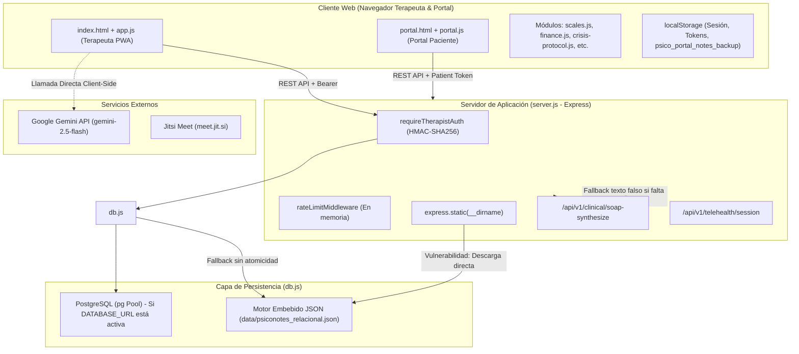

# AUDIT_REPORT.md — Auditoría Integral y Diagnóstico Técnico Clínico
**Proyecto:** Psico Notes Clinical  
**Versión Auditada:** v6.0 / v6.7.0  
**Fecha:** 21 de Octubre de 2026  
**Equipo Auditor:** Arquitecto Full-Stack, Seguridad Web, UX/UI SaaS, QA & Automatización, Privacidad PHI, PM Clínico  
**Estado:** Fase 0 Completada — Hallazgos Confirmados, Evidencias en Código y Línea Base de Pruebas

---

## 1. Resumen Ejecutivo

Psico Notes Clinical es una aplicación diseñada para la gestión clínica, psicoterapéutica y administrativa de consultorios de salud mental. Cuenta con un cliente web enriquecido (SPA PWA), un portal para pacientes y un backend en Node.js/Express con soporte dual para base de datos relacional (PostgreSQL) y un motor embebido JSON local (`data/psiconotes_relacional.json`).

La auditoría técnica profunda realizada en la **Fase 0** ha determinado que, si bien la plataforma posee una amplia gama de funcionalidades clínicas (notas SOAP, protocolos de crisis, consentimiento informado, escalas psicométricas PHQ-9/GAD-7, vademécum, facturación e integración con IA), **presenta vulnerabilidades de seguridad y fallos de integridad de datos de severidad crítica (P0)** que impiden su uso seguro en entornos de producción con pacientes y terapeutas reales sin una remediación previa.

### Puntos clave del diagnóstico:
1. **Exposición masiva de datos clínicos protegidos (PHI) sin autenticación:** La configuración de archivos estáticos en Express expone el archivo `data/psiconotes_relacional.json` públicamente por omisión de la extensión `.json` en la lista de exclusión.
2. **Fabricación de contenido clínico artificial por fallback de IA:** El backend genera notas clínicas estructuradas falsas con código HTTP 200 cuando no hay una clave API configurada.
3. **Fugas de aislamiento multitenant (BOLA / IDOR):** Registros de pacientes huérfanos (`therapist_id = null`) son expuestos a cualquier terapeuta autenticado.
4. **Bypass de autenticación y exposición de hashes en el registro:** El endpoint `/api/v1/auth/register` permite secuestrar sesiones y retorna el hash de la contraseña si coincide el ID.
5. **Riesgo de corrupción y borrado silencioso de expedientes:** La capa de persistencia JSON carece de escrituras atómicas y reemplaza la base de datos por un esquema vacío si ocurre un fallo de lectura.
6. **Desconexión entre frontend y backend en flujos vitales:** El portal SOS y las salas de teleconsulta seguras implementadas en el servidor no son consumidas por la interfaz de usuario.
7. **Línea base de compilación:** Las 66 pruebas en `tests.js` pasan exitosamente, pero el script de linting (`tsc --noEmit`) falla debido a un error de sintaxis preexistente en `app.js:994` (llave de cierre huérfana).

---

## 2. Arquitectura Actual del Sistema



### Componentes de la Arquitectura:
- **Frontend Terapeuta:** Vanilla JavaScript, HTML5, CSS3, Service Worker (`sw.js`). Maneja estado global en `AppState`, persistencia en `localStorage` con cifrado parcial AES-GCM derivado de `userId`.
- **Portal del Paciente:** Interfaz ligera (`portal.html`, `portal.js`, `portal.css`) autenticada mediante tokens alfanuméricos de 6 dígitos. Permite autoregistro ABC, monitoreo de ánimo y botón SOS.
- **Backend API Gateway:** Express.js (`server.js`) con 28 endpoints REST que gestionan autenticación, sincronización de pacientes, facturación fiscal, teleconsulta y auditoría.
- **Capa de Datos:** `db.js` implementa un conector dual. Si `DATABASE_URL` está presente, utiliza `pg.Pool`; si no, opera contra `data/psiconotes_relacional.json`.

---

## 3. Inventario de Módulos y Dependencias

### 3.1 Módulos Funcionales
| Módulo | Archivos Principales | Propósito Clínico / Técnico |
|---|---|---|
| **Autenticación y Sesión** | `server.js`, `app.js` | Login, registro, token Bearer HMAC-SHA256, recuperación de contraseña. |
| **Expediente y Pacientes** | `index.html`, `app.js`, `historia-clinica.js` | Alta de pacientes, ciclo vital (niñez, adolescencia, adultez), anamnesis, preconsulta. |
| **Notas de Evolución (SOAP)** | `app.js`, `ai-clinical.js`, `server.js` | Redacción SOAP, estructuración asistida por IA, inmutabilidad y adendums. |
| **Evaluaciones Psicométricas** | `scales.js`, `app.js` | Escalas PHQ-9, GAD-7, C-SSRS, editor de escalas personalizadas con cálculo de severidad. |
| **Agenda y Citas** | `app.js`, `session-reminders.js` | Calendario multi-vista, recordatorios, transiciones de estado de cita. |
| **Protocolo de Crisis y SOS** | `crisis-protocol.js`, `portal.js`, `server.js` | Detección de ideación suicida, botón de pánico, desactivación de crisis. |
| **Portal del Paciente** | `portal.html`, `portal.js`, `portal.css` | Tareas intersesión, botiquín de calma, autoregistro de pensamientos CBT. |
| **Finanzas y Facturación** | `finance.js`, `server.js`, `db.js` | Control de cobros, recibos, facturación compatible con marco SENIAT (Venezuela). |
| **Vademécum Farmacológico** | `vademecum.js` | Catálogo de psicofármacos, dosis, advertencias e interacciones. |
| **Anonimizador PHI** | `phi-anonymizer.js` | Desidentificación de nombres, teléfonos y correos previo a procesamiento por IA. |
| **Teleconsulta** | `server.js`, `app.js` | Generación de enlaces de videoconferencia con Jitsi Meet. |

### 3.2 Dependencias del Sistema (`package.json`)
- `express` (^4.21.2): Servidor HTTP y API REST.
- `pg` (^8.23.1): Driver de conexión PostgreSQL.
- `@google/genai` (^2.4.0): SDK oficial de Google Gemini.
- `dotenv` (^17.2.3): Carga de variables de entorno.
- `react` / `react-dom` (^19.0.1): Declaradas pero el sistema opera principalmente con arquitectura Vanilla JS / PWA.
- `vite` (^6.2.3): Empaquetador y servidor de desarrollo.
- `typescript` (~5.8.2): Verificación de tipos estáticos (`tsc`).

---

## 4. Hallazgos Confirmados con Evidencias en Código

### [HALLAZGO-01] [CRÍTICO - P0] Fuga Masiva de PHI: Base de Datos JSON Descargable sin Autenticación
- **Archivo y Línea:** `server.js:236-266`
- **Evidencia Técnica:**
  El cortafuegos de archivos restringe extensiones `.env`, `.sql`, `.yml`, `.yaml`, `.log`, y nombres fijos como `server.js`, `db.js`, `schema.sql`. Sin embargo:
  1. No incluye `.json` en `RESTRICTED_EXTS`.
  2. No incluye `psiconotes_relacional.json` en `RESTRICTED_FILES`.
  3. `app.use(express.static(__dirname))` sirve todos los archivos de la raíz.
  Cualquier cliente no autenticado puede ejecutar:
  `GET http://localhost:3000/data/psiconotes_relacional.json` y descargar inmediatamente más de 200 expedientes clínicos, diagnósticos, teléfonos, nombres de menores de edad y hashes de contraseñas de terapeutas.
- **Impacto Clínico:** Violación masiva del secreto profesional médico y de leyes de protección de datos (HIPAA, RGPD, normativas locales). Exposición pública del historial psiquiátrico de los pacientes.
- **Corrección Propuesta:**
  1. Mover la carpeta `data/` fuera del directorio servido por `express.static` o excluir explícitamente `/data/*` y extensiones `.json` en el middleware de archivos protegidos.
  2. Servir únicamente la carpeta `dist` o un directorio público explícito (`public/`) en lugar de `__dirname`.
- **Criterio de Aceptación:** Una petición HTTP `GET /data/psiconotes_relacional.json` debe responder `403 Forbidden` o `404 Not Found`.

---

### [HALLAZGO-02] [CRÍTICO - P0] Generación de Información Clínica Inventada en Endpoint SOAP
- **Archivo y Línea:** `server.js:625-632`
- **Evidencia Técnica:**
  ```javascript
  if (!apiKey) {
      return res.json({
          subjetivo: `El paciente expone vivencias y sintomatología vinculada a: ${notes.substring(0, 100)}...`,
          objetivo: `Orientado en tiempo y espacio. Contacto visual adecuado, discurso coherente y lenguaje fluido.`,
          analisis: `Evolución favorable con necesidad de afianzar técnicas de regulación emocional y reestructuración.`,
          plan: `1. Mantener autoregistro intersesión.\n2. Ejercicios de respiración diafragmática.\n3. Próxima consulta en 7 días.`
      });
  }
  ```
  Si no se configura `GEMINI_API_KEY`, el servidor devuelve un objeto SOAP con texto clínico ficticio con código `200 OK`.
- **Impacto Clínico:** Un paciente con agitación psicomotriz o ideación suicida podría quedar registrado como "Orientado en tiempo y espacio, evolución favorable" sin que el profesional haya validado esos datos, generando consecuencias médico-legales fatales.
- **Corrección Propuesta:** Responder con `503 Service Unavailable` indicando que el servicio de IA no está configurado. Jamás generar texto clínico sintético simulado como real. Exigir bandera explícita de origen (`source: 'ai' | 'manual'`) y validación obligatoria del terapeuta.
- **Criterio de Aceptación:** Si `GEMINI_API_KEY` no está presente, `POST /api/v1/clinical/soap-synthesize` debe responder HTTP 503 con error descriptivo y nunca HTTP 200 con notas clínicas inventadas.

---

### [HALLAZGO-03] [CRÍTICO - P0] Aislamiento BOLA/IDOR Ineficaz para Expedientes Huérfanos
- **Archivo y Línea:** `db.js:677`, `server.js:478`
- **Evidencia Técnica:**
  1. En `db.js:677`:
     ```javascript
     return this.localStore.patients.filter(p => !p.therapist_id || p.therapist_id === therapistId);
     ```
     Si un paciente no tiene `therapist_id` asignado, se incluye en el listado devuelto a **cualquier** terapeuta.
  2. En `server.js:478`:
     ```javascript
     if (data.patient.therapist_id && data.patient.therapist_id !== req.therapistId) { ... return 403; }
     ```
     Si `therapist_id` es `null`, la condición es `false` y se concede acceso completo al expediente ajeno en `GET /api/v1/portal/data/:patientId`.
  3. En `db.js:523` (`saveTherapistCloudSync`): la sincronización en lote no propaga el `therapistId` a los pacientes, provocando que los nuevos pacientes sincronizados nazcan sin dueño (`therapist_id = null`).
- **Impacto Clínico:** Un terapeuta recién registrado puede visualizar y manipular expedientes y evaluaciones de pacientes pertenecientes a otros colegas de la clínica.
- **Corrección Propuesta:**
  1. Condición estricta de aislamiento: Si `!patient.therapist_id || patient.therapist_id !== req.therapistId`, denegar acceso (`403 Forbidden`).
  2. Asignar siempre de forma obligatoria e inmutable el `therapistId` autenticado en toda creación y sincronización de pacientes.
  3. Ejecutar migración de saneamiento de datos para asociar los expedientes huérfanos actuales.
- **Criterio de Aceptación:** Cualquier consulta a un paciente con `therapist_id = null` o perteneciente a otro terapeuta debe retornar `403 Forbidden`.

---

### [HALLAZGO-04] [CRÍTICO - P0] Bypass de Autenticación y Fuga de Hash de Contraseña en `/api/v1/auth/register`
- **Archivo y Línea:** `server.js:762-771`
- **Evidencia Técnica:**
  ```javascript
  if (passwordHash && (existing.password_hash === passwordHash || (id && existing.id === id))) {
      const sessionToken = generateSessionToken(existing.id, existing.email);
      return res.json({
          status: 'ok',
          sessionToken,
          therapist: existing // Contiene existing.password_hash
      });
  }
  ```
  Si un atacante conoce el email y el ID de un terapeuta (ej. de una exportación o log), puede enviar cualquier `passwordHash` arbitrario. Como `existing.id === id` se cumple, el backend le entrega una sesión activa y le devuelve en la respuesta JSON el objeto del usuario incluyendo `password_hash`.
- **Impacto Técnico y Clínico:** Suplantación total de cuentas de terapeutas sin conocer su contraseña y robo de credenciales criptográficas.
- **Corrección Propuesta:**
  1. Eliminar la cláusula `(id && existing.id === id)` del endpoint de registro.
  2. El registro nunca debe actuar como un login alternativo sin validar estrictamente las credenciales.
  3. Eliminar `password_hash` de cualquier respuesta HTTP.
- **Criterio de Aceptación:** Una petición a `/api/v1/auth/register` con un email existente y una contraseña incorrecta debe responder `409 Conflict` o `401 Unauthorized`, sin emitir token ni exponer hashes.

---

### [HALLAZGO-05] [CRÍTICO - P0] Riesgo de Corrupción y Destrucción Silenciosa del Almacén de Datos
- **Archivo y Línea:** `db.js:28-35`, `db.js:54-60`
- **Evidencia Técnica:**
  1. En `_loadLocalStore()`:
     ```javascript
     try {
         if (fs.existsSync(LOCAL_DB_PATH)) return JSON.parse(fs.readFileSync(LOCAL_DB_PATH, 'utf8'));
     } catch (e) {
         console.warn('⚠️ Error al leer almacén local, iniciando nuevo:', e.message);
     }
     return { therapists: [], patients: [], ... };
     ```
     Si ocurre un fallo de lectura o el JSON se encuentra temporalmente truncado por escrituras concurrentes, se genera una estructura en blanco en memoria.
  2. En `_persistLocalStore()`:
     `fs.writeFileSync(LOCAL_DB_PATH, ...)` escribe directamente sobre el archivo de producción sin archivo temporal intermedio (`.tmp + rename`) ni copia de seguridad preventiva. La primera escritura posterior destruye permanentemente el archivo original de 500+ KB, dejando 0 pacientes.
  3. No existe bloqueo de concurrencia (file lock) entre peticiones simultáneas.
- **Impacto Clínico:** Pérdida irreversible de la historia clínica de cientos de pacientes ante un reinicio abrupto o concurrencia de escrituras.
- **Corrección Propuesta:**
  1. Implementar escritura atómica: escribir primero a `psiconotes_relacional.json.tmp` y realizar `fs.renameSync`.
  2. Crear respaldo automático con rotación previa a cada escritura crítica (`.bak`).
  3. Si `JSON.parse` falla al iniciar, lanzar error fatal impidiendo que el servidor arranque y sobrescriba el archivo corrupto.
- **Criterio de Aceptación:** Una interrupción durante el proceso de persistencia no debe provocar la pérdida del archivo de datos anterior. Si el archivo está dañado, el sistema debe negarse a sobrescribirlo en blanco.

---

### [HALLAZGO-06] [ALTO - P1] Clave de Gemini Expuesta en Frontend y Cifrado Inseguro en `localStorage`
- **Archivo y Línea:** `ai-clinical.js:23-40`, `ai-clinical.js:77-85`, `app.js:264`, `app.js:728`
- **Evidencia Técnica:**
  1. `ai-clinical.js:36` almacena la clave de API con `btoa(this.apiKey)`. Base64 es una codificación reversible, no un mecanismo de cifrado.
  2. `ai-clinical.js:77` realiza llamadas a Google Gemini (`https://generativelanguage.googleapis.com/...`) directamente desde el navegador del usuario en lugar de canalizarlas por el backend autenticado.
  3. `app.js:728` guarda una copia en texto plano sin cifrar de todas las notas clínicas en `localStorage.setItem('psico_portal_notes_backup', JSON.stringify(AppState.notes))`, invalidando el cifrado AES-GCM que se aplica en las líneas anteriores.
- **Impacto Técnico y Clínico:** Exposición de claves privadas de IA al tráfico de red y posibilidad de robo de notas clínicas completas mediante ataques XSS locales.
- **Corrección Propuesta:**
  1. Canalizar todas las peticiones de IA exclusivamente a través del endpoint `/api/v1/clinical/soap-synthesize` del backend.
  2. Eliminar el almacenamiento de claves API en `localStorage`.
  3. Eliminar la clave desprotegida `psico_portal_notes_backup` en `localStorage`.
- **Criterio de Aceptación:** No debe existir ninguna referencia ni valor de API Key de Gemini en el almacenamiento local del navegador, y ninguna llamada de red a `googleapis.com` debe salir desde el cliente web.

---

### [HALLAZGO-07] [ALTO - P1] Alertas de Crisis y Teleconsulta Segura Inoperantes por Desconexión FE↔BE
- **Archivo y Línea:** `app.js:6514`, `server.js:493`, `tests.js:1884`
- **Evidencia Técnica:**
  1. El backend implementa `GET /api/v1/portal/crisis-alerts` para notificar al terapeuta sobre pacientes que activaron el protocolo SOS. Sin embargo, ningún script del frontend terapeuta (`app.js`) realiza peticiones a este endpoint. Las alertas quedan huérfanas en la base de datos hasta que el terapeuta abre manualmente la ficha específica de ese paciente.
  2. El backend implementa salas de teleconsulta seguras de 192 bits en `/api/v1/telehealth/session` (`server.js:694`). Sin embargo, el frontend terapeuta (`app.js:6514`) genera una sala Jitsi estática y predecible:
     `https://meet.jit.si/psiconotes-clinical-${cleanRoom}`.
- **Impacto Clínico:** Un paciente en situación de emergencia vital no recibe atención oportuna porque el panel del terapeuta no se entera del evento SOS. Además, la sala de teleconsulta puede ser interceptada por terceros al tener un nombre predecible.
- **Corrección Propuesta:**
  1. Integrar el polling o notificación de alertas SOS desde el dashboard del terapeuta consumiendo `/api/v1/portal/crisis-alerts`.
  2. Modificar la función de inicio de teleconsulta en `app.js` para que solicite la sala segura al backend (`/api/v1/telehealth/session`).
- **Criterio de Aceptación:** Al presionar SOS en el portal, el dashboard del terapeuta debe mostrar una alerta visible de emergencia. La sala de teleconsulta abierta debe coincidir con el nonce criptográfico generado por el servidor.

---

### [HALLAZGO-08] [ALTO - P1] Secreto de Sesión Hardcodeado por Defecto y Sin Fallo Rápido en Producción
- **Archivo y Línea:** `server.js:27`
- **Evidencia Técnica:**
  ```javascript
  const SESSION_SECRET = process.env.SESSION_SECRET || 'psico-clinical-hmac-sha256-secret-key-prod-v6-2026';
  ```
  Si no se declara `SESSION_SECRET` en `.env`, el sistema utiliza una clave fija pública idéntica en todas las instalaciones. Además, no impide el inicio del servidor en producción si la variable está ausente.
- **Impacto Técnico:** Cualquier atacante puede generar tokens Bearer HMAC válidos para cualquier ID de terapeuta y acceder a la plataforma con privilegios completos.
- **Corrección Propuesta:**
  1. Impedir el inicio del servidor (`process.exit(1)`) si `NODE_ENV === 'production'` y `SESSION_SECRET` no está configurado o coincide con el valor predeterminado.
  2. Exigir una longitud mínima de 32 caracteres criptográficos para el secreto.
- **Criterio de Aceptación:** El servidor debe rehusarse a iniciar en modo producción sin un `SESSION_SECRET` seguro.

---

### [HALLAZGO-09] [MEDIO - P2] Rate Limiter Penaliza Solicitudes Exitosas y es Evasible por `X-Forwarded-For`
- **Archivo y Línea:** `server.js:172-204`
- **Evidencia Técnica:**
  1. `rateLimitMiddleware` incrementa el contador en cada petición antes de procesarla. Un terapeuta que inicie sesión 5 veces en 15 minutos queda bloqueado en el 6.º intento con HTTP 429 ("Demasiados intentos fallidos"), a pesar de que sus credenciales hayan sido correctas.
  2. Toma `req.headers['x-forwarded-for']` ciegamente sin `app.set('trust proxy', ...)`, permitiendo a atacantes evadir el bloqueo simplemente variando la cabecera enviada.
- **Corrección Propuesta:**
  1. Contabilizar únicamente los intentos fallidos (`401 Unauthorized`) para el bloqueo por fuerza bruta.
  2. Configurar la validación adecuada de proxy en Express.

---

### [HALLAZGO-10] [MEDIO - P2] Flujo de Recuperación de Contraseña Inutilizable en Producción
- **Archivo y Línea:** `server.js:845-847`, `package.json`
- **Evidencia Técnica:**
  El endpoint `POST /api/v1/auth/forgot-password` genera un código de verificación de 6 dígitos y lo guarda en la base de datos. Sin embargo, no existe servicio de envío de correos (ni Nodemailer ni API de correo en `package.json`). En la consola del servidor se imprime `[PROTEGIDO EN AUDITORÍA]`, por lo que el código no se envía al usuario ni puede ser consultado por el operador.
- **Impacto Clínico:** Un profesional que olvide su contraseña queda bloqueado permanentemente del sistema sin posibilidad de recuperar el acceso a sus expedientes.
- **Corrección Propuesta:**
  1. Configurar un proveedor transaccional de correo para entornos de producción.
  2. En entornos de desarrollo / pruebas locales, registrar el código de forma controlada o permitir un canal de soporte administrativo.

---

### [HALLAZGO-11] [MEDIO - P2] Emisión de Facturas Fiscales Falsas con Cuerpos Vacíos
- **Archivo y Línea:** `server.js:920-926`, `db.js:793-814`
- **Evidencia Técnica:**
  `POST /api/v1/billing/invoices` no valida la presencia de montos, paciente o RIF. Si se envía un cuerpo vacío `{}`, genera una factura con número `FACT-0001`, monto 0 USD y estado `emitida`.
- **Impacto Técnico:** Generación de registros inconsistentes e inutilidad de los reportes fiscales.
- **Corrección Propuesta:** Validar esquema y campos obligatorios (`patient_id`, `amountUSD` > 0, etc.) antes de persistir.

---

## 5. Hallazgos Sospechosos Pendientes de Validar en Ejecución

1. **Persistencia Silenciosa en Desconexión de PostgreSQL:**
   Si la base de datos PostgreSQL se desconecta durante la operación continua, verificar si las consultas en curso fallan de forma controlada o si caen en un estado incoherente mixto entre memoria y base de datos.
2. **Expiración y Revocación de Tokens de Sesión en Logout:**
   El endpoint `/api/v1/auth/reset-password` no revoca tokens emitidos previamente. Un terapeuta que cambie su contraseña por sospecha de compromiso mantendrá sesiones activas válidas hasta por 7 días.
3. **Cálculo de Moneda y Pérdida de Precisión Decimal en Facturas:**
   El módulo `finance.js` utiliza tipos de punto flotante estándar de JavaScript (`Number`, `parseFloat`). Se debe verificar el redondeo en cálculos con tasa de cambio IGTF para evitar descuadres en céntimos.

---

## 6. Pruebas Ejecutadas y Línea Base de Calidad

| Comando Ejecutado | Resultado | Detalle y Observaciones |
|---|---|---|
| `git status` | Falló (Entorno) | `git` no está reconocido en el PATH del sistema Windows actual. |
| `node tests.js` | **66/66 PASARON** | Pruebas unitarias de cifrado, psicometría, SOAP, balance financiero y seguridad básica pasaron en 1.25 segundos. |
| `node .\node_modules\typescript\bin\tsc --noEmit` | **FALLÓ (Preexistente)** | `app.js(994,1): error TS1128: Declaration or statement expected.` Llave de cierre extra en la función `handleSubmitNewPassword`. |
| `node .\node_modules\vite\bin\vite.js build` | **EXITOSO CON ADVERTENCIAS** | Generó bundle en `dist/` en 801 ms. Advirtió que 16 scripts en `index.html` no tienen `type="module"`. |

---

## 7. Los Cinco Riesgos Más Importantes

1. **Riesgo 1 (P0): Descarga no autenticada de toda la base de datos clínica (`/data/psiconotes_relacional.json`).** Fuga inmediata de toda la información médica confidencial.
2. **Riesgo 2 (P0): Fabricación de registros clínicos artificiales por fallback de IA.** El sistema guarda notas médicas falsas con código 200 cuando no hay conexión con Gemini.
3. **Riesgo 3 (P0): Aislamiento BOLA/IDOR roto para pacientes huérfanos.** Cualquier terapeuta puede ver y modificar pacientes sin dueño asignado.
4. **Riesgo 4 (P0): Bypass de autenticación y exposición de credenciales en `/api/v1/auth/register`.** Inicio de sesión ilegítimo que revela el hash de contraseña.
5. **Riesgo 5 (P0): Destrucción de la historia clínica por corrupción silenciosa del JSON.** Falta de atomicidad en la escritura y reseteo del archivo si ocurre un error de lectura.

---

## 8. Propuesta Concreta para la Iteración 1 (Fase 1: Seguridad Crítica)

Para mitigar inmediatamente los riesgos P0 que comprometen la legalidad y viabilidad del sistema:

### Objetivos de la Iteración 1:
1. **Bloquear la fuga de datos en `server.js`:**
   - Prohibir estrictamente el acceso a `/data/*` y a cualquier archivo `.json` desde el servidor estático.
   - Configurar un directorio público restringido para archivos estáticos.
2. **Corregir el aislamiento multi-tenant en `db.js` y `server.js`:**
   - Denegar acceso a cualquier paciente cuyo `therapist_id` no coincida exactamente con el terapeuta autenticado.
   - Asegurar que `syncPatientsBatch` y la sincronización en la nube asignen obligatoriamente el `therapist_id`.
3. **Erradicar el bypass de autenticación y fuga de contraseñas en `server.js`:**
   - Eliminar la condición `existing.id === id` en `/api/v1/auth/register`.
   - Limpiar `password_hash` de cualquier payload de salida.
4. **Corregir el fallback de IA en `server.js`:**
   - Retornar HTTP 503 si `GEMINI_API_KEY` no está configurada; eliminar cualquier texto clínico simulado.
5. **Implementar persistencia atómica y a prueba de fallos en `db.js`:**
   - Escritura mediante archivo temporal (`.tmp`) y renombrado atómico (`fs.renameSync`).
   - Abortar con error en lugar de inicializar un almacén vacío si el archivo JSON se corrompe.
6. **Reparar el error sintáctico de TypeScript en `app.js` (Línea 994):**
   - Eliminar la llave de cierre redundante para restablecer la línea base de linting limpio.

### Archivos a Modificar en la Iteración 1:
- `server.js`
- `db.js`
- `app.js`
- `tests.js` (añadiendo casos de prueba específicos que verifiquen el bloqueo de las vulnerabilidades corregidas)
