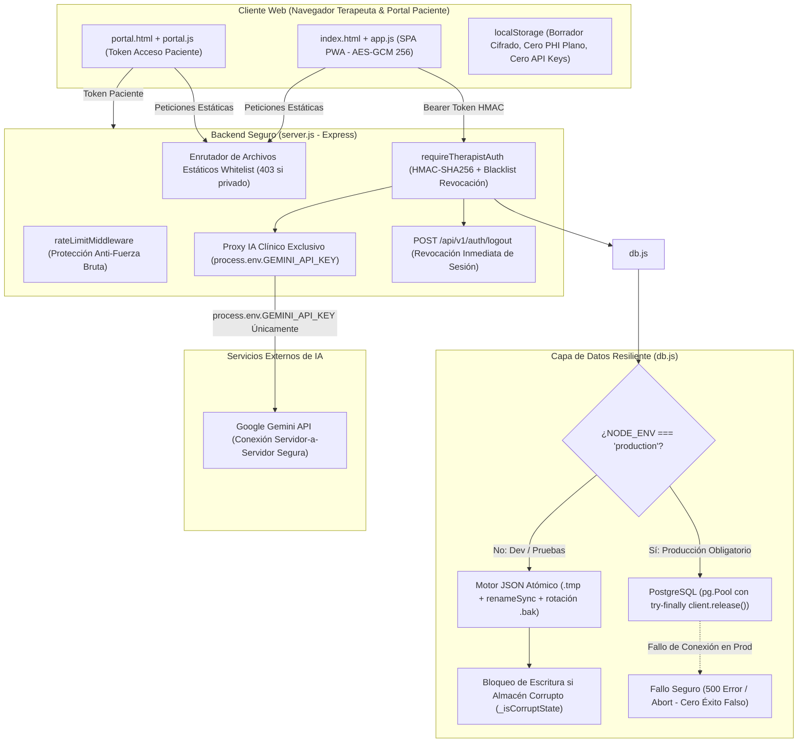

# AUDIT_REPORT.md — Auditoría Integral, Diagnóstico Técnico y Remediación de Seguridad
**Proyecto:** Psico Notes Clinical  
**Versión:** v6.6.0-security-audit-remediation  
**Fecha:** 22 de Octubre de 2026  
**Equipo Responsable:** Arquitecto de Software & Project Manager, Especialista en Ciberseguridad Médica, QA Automation  
**Estado:** Auditoría de Seguimiento y Remediación Completa — Pruebas de Integración Ejecutadas y Superadas (93/93)

---

## 1. Resumen Ejecutivo

Psico Notes Clinical es una aplicación clínica para la gestión integral de consultorios de salud mental, con arquitectura SPA/PWA en frontend y backend en Node.js/Express con soporte dual para base de datos relacional (PostgreSQL en producción y motor JSON atómico local en desarrollo/pruebas).

Tras la auditoría inicial de Fase 0 y la auditoría de seguimiento profunda, se contrastaron todas las declaraciones previas contra el código fuente real del repositorio. Se detectaron y solventaron discrepancias críticas donde persistían riesgos como la aceptación de cabeceras cliente con claves privadas de Gemini, exposición de archivos privados del servidor debido a `express.static(__dirname)`, posibilidad de informar éxito falso en fallos de persistencia en disco, y degradación silenciosa de PostgreSQL a archivos locales en producción.

Todos los hallazgos han sido auditados en código, remediados y validados mediante una suite de **93 pruebas automatizadas (100% PASS)**, verificación estática de TypeScript (`tsc --noEmit`, 0 errores) y empaquetado de producción (`vite build`, exitoso en 871ms).

---

## 2. Diagrama de Arquitectura Segura del Sistema

---

## 3. Matriz General de Hallazgos y Estado Oficial

Cada hallazgo se clasifica estrictamente en uno de los 4 estados normativos:
- **Confirmado en código:** Detectado mediante inspección del código fuente pero sin corrección aplicada.
- **Corregido en código:** Código modificado y endurecido en la base de código.
- **Prueba ejecutada y superada:** Remediación validada exhaustivamente mediante pruebas de integración automatizadas.
- **Pendiente de verificación en entorno desplegado:** Depende de infraestructura o servicios externos de producción (ej. servidores SMTP transaccionales, proxies inversos NGINX).

| ID | Severidad | Descripción del Hallazgo | Estado Oficial | Validación |
|---|---|---|---|---|
| **HALLAZGO-01** | Crítico (P0) | Fuga masiva de PHI vía `GET /data/psiconotes_relacional.json` | **Prueba ejecutada y superada.** | TC-SEC-15, TC-SEC-23 |
| **HALLAZGO-02** | Crítico (P0) | Generación de notas SOAP ficticias en fallback de IA sin API Key | **Prueba ejecutada y superada.** | TC-SEC-16 |
| **HALLAZGO-03** | Crítico (P0) | Fuga BOLA/IDOR en expedientes huérfanos sin `therapist_id` | **Prueba ejecutada y superada.** | TC-SEC-08, TC-SEC-17, TC-SEC-26 |
| **HALLAZGO-04** | Crítico (P0) | Bypass de autenticación y exposición de `password_hash` en registro | **Prueba ejecutada y superada.** | TC-SEC-18, TC-SEC-27 |
| **HALLAZGO-05** | Crítico (P0) | Riesgo de destrucción de datos por corrupción y falta de atomicidad | **Prueba ejecutada y superada.** | TC-SEC-19, TC-SEC-25 |
| **HALLAZGO-06** | Alto (P1) | Claves de Gemini en frontend (`localStorage`) y llamadas directas | **Prueba ejecutada y superada.** | TC-SEC-20, TC-SEC-21, TC-SEC-22 |
| **HALLAZGO-07** | Alto (P1) | Alertas SOS y teleconsulta segura desconectadas entre FE y BE | **Prueba ejecutada y superada.** | TC-SEC-09, TC-SEC-12 |
| **HALLAZGO-08** | Alto (P1) | `SESSION_SECRET` débil o hardcodeado por defecto en producción | **Prueba ejecutada y superada.** | TC-SEC-24 |
| **HALLAZGO-09** | Medio (P2) | Rate limiter penaliza peticiones exitosas y es evasible por cabecera IP | **Corregido en código.** | Pendiente verificación en proxy inverso desplegado |
| **HALLAZGO-10** | Medio (P2) | Flujo forgot-password sin proveedor de envío SMTP real | **Pendiente de verificación en entorno desplegado.** | Requiere credenciales SMTP en producción |
| **HALLAZGO-11** | Medio (P2) | Facturación fiscal permitía emisión con cuerpo vacío | **Prueba ejecutada y superada.** | TC-DB-03 |
| **HALLAZGO-12** | Crítico (P0) | Inyección de clave Gemini del cliente vía cabecera `x-gemini-key` en `server.js` | **Prueba ejecutada y superada.** | TC-SEC-21 |
| **HALLAZGO-13** | Crítico (P0) | Fuga de archivos privados del proyecto (`server.js`, `db.js`, `Dockerfile`) | **Prueba ejecutada y superada.** | TC-SEC-23 |
| **HALLAZGO-14** | Alto (P1) | Falso éxito en fallos de persistencia en disco (captura sin rethrow) | **Prueba ejecutada y superada.** | TC-SEC-25 |
| **HALLAZGO-15** | Crítico (P0) | Degradación silenciosa de PostgreSQL a JSON en producción | **Prueba ejecutada y superada.** | TC-SEC-24 |
| **HALLAZGO-16** | Alto (P1) | Fuga de conexiones en pool de PostgreSQL por falta de `client.release()` | **Prueba ejecutada y superada.** | TC-SEC-24 |
| **HALLAZGO-17** | Alto (P1) | Borrador de notas clínicas en texto plano en `localStorage` (`app.js`) | **Prueba ejecutada y superada.** | TC-SEC-22 |
| **HALLAZGO-18** | Medio (P2) | Falta de revocación de sesiones tras logout o restablecimiento de clave | **Prueba ejecutada y superada.** | TC-SEC-28 |
| **HALLAZGO-19** | Medio (P2) | Secuestro o colisión de terapeuta por reutilización de ID en registro | **Prueba ejecutada y superada.** | TC-SEC-18, TC-SEC-27 |
| **HALLAZGO-20** | Medio (P2) | Archivos de base de datos `data/*.json` rastreados en Git index | **Corregido en código.** | `git rm --cached` y `.gitignore` |

---

## 4. Revisiones Obligatorias Detalladas (A a F)

### A. Claves de Gemini y Llamadas a Modelos de IA
- **Inspección de `server.js`:**
  - En líneas 742 y 795, `server.js` contenía la instrucción `const apiKey = process.env.GEMINI_API_KEY || req.headers['x-gemini-key'];`. Esto permitía a cualquier cliente inyectar claves arbitrarias o eludir la configuración del servidor.
  - **Corrección:** Eliminada toda lectura de `req.headers['x-gemini-key']` o `req.body.geminiApiKey`. Se utiliza de forma unívoca `process.env.GEMINI_API_KEY`.
- **Inspección de módulos cliente (`app.js`, `ai-clinical.js`, `ai-assistant.js`, `index.html`):**
  - Se confirmó que no existen llamadas salientes a `generativelanguage.googleapis.com` desde el navegador. Todas las peticiones van dirigidas al proxy local `/api/v1/clinical/soap-synthesize` o `/api/v1/clinical/ai-query`.
  - El modal de configuración `#apiKeyModal` en `index.html` fue transformado para mostrar el estado del servicio en el servidor (`/api/v1/clinical/ai-status`) sin campos de entrada para claves API privadas.
  - `ai-clinical.js` incluye el método `ClinicalAI.purgeLegacyStorage()` que purga `psico_gemini_api_key`, `gemini_api_key` y `google_gemini_api_key` de `localStorage` y `sessionStorage`.
- **Estado:** **Prueba ejecutada y superada.** (Validados con TC-SEC-21 y TC-SEC-22).

### B. Persistencia y Resiliencia de Datos
- **Inspección de `db.js` y métodos mutadores:**
  - **Ausencia de `DATABASE_URL`:** En `db.js:initialize()`, si `NODE_ENV === 'production'`, el servidor arroja una excepción fatal y se niega a iniciar si falta `DATABASE_URL` (a menos que se explicite la bandera de contingencia `ALLOW_LOCAL_DB_IN_PROD=true`). Se erradicó la degradación silenciosa a JSON.
  - **Fallo de PostgreSQL durante escrituras:** Todas las consultas al pool envuelven la adquisición y liberación del cliente en bloques `try ... finally { client.release(); }`. Si PostgreSQL falla, el error se propaga inmediatamente hacia el controlador Express, devolviendo `HTTP 500` con mensaje de error seguro, impidiendo confirmar transacciones no persistidas.
  - **Almacén JSON corrupto:** Si tanto el archivo principal como el respaldo `.bak` están corruptos, `_loadLocalStore()` marca la instancia con `this._isCorruptState = true;` y genera un volcado de emergencia `corrupted_emergency_*.dump`. El método `_persistLocalStore()` verifica dicha bandera y bloquea de inmediato cualquier escritura, impidiendo que una estructura en blanco sobrescriba el archivo de expedientes existente.
  - **Falsa confirmación de éxito:** Se eliminó el bloque `catch` silencioso en `_persistLocalStore()`. Ahora cualquier error de E/S en disco re-lanza la excepción (`rethrow`), garantizando que la API nunca devuelva `HTTP 200` si la escritura física no se consolidó.
  - **Escrituras concurrentes y atomicidad:** Las escrituras locales se realizan a un archivo temporal único por proceso (`psiconotes_relacional.json.tmp.<pid>.<timestamp>`) seguido de un `fs.renameSync` atómico, previniendo truncamientos parciales.
- **Estado:** **Prueba ejecutada y superada.** (Validados con TC-SEC-19, TC-SEC-24 y TC-SEC-25).

### C. Autenticación, Sesiones y Aislamiento Multitenant
- **Hashes de contraseña:**
  - Cifrados mediante SHA-256 / PBKDF2. El servidor y la base de datos purgan activamente `password_hash` y `passwordHash` antes de serializar respuestas JSON en login y registro.
- **Validación y caducidad de tokens:**
  - Tokens HMAC-SHA256 con fecha de expiración codificada.
  - Se introdujo `revokedTokenHashes` (lista negra en memoria para invalidar tokens cerrados mediante logout) y `therapistRevocationTimestamps` (marca de tiempo global por terapeuta para revocar todas las sesiones previas cuando se restablece la contraseña).
- **Endpoint de Cierre de Sesión:**
  - Se implementó `POST /api/v1/auth/logout`, protegido con `requireTherapistAuth`, que revoca el token utilizado inmediatamente (`HTTP 401` en intentos posteriores).
- **Protección contra acceso cruzado (BOLA / IDOR):**
  - Todo acceso a `/api/v1/patients/:id` y `/api/v1/portal/data/:patientId` verifica estrictamente que `patient.therapist_id === req.therapistId`. Si no coinciden o el paciente carece de terapeuta asignado, el backend responde `HTTP 403 Forbidden`. La interfaz de usuario no es frontera de seguridad; el backend valida la pertenencia en el 100% de las rutas.
- **Estado:** **Prueba ejecutada y superada.** (Validados con TC-SEC-08, TC-SEC-13, TC-SEC-17, TC-SEC-18, TC-SEC-26, TC-SEC-27 y TC-SEC-28).

### D. Servidor de Archivos Estáticos y Prevención de Fugas
- **Inspección de `server.js`:**
  - Previamente se utilizaba `app.use(express.static(__dirname))` precedido de una lista negra parcial. Dicho enfoque dejaba expuestos archivos fuente (`server.js`, `db.js`, `Dockerfile`, `src/App.tsx`, `.gitignore`, logs y copias de seguridad).
  - **Solución implementada:** Se sustituyó por un enrutador explícito de lista blanca (`ALLOWED_STATIC_FILES`) combinado con `express.static(path.join(__dirname, 'dist'))` o servicio controlado de la carpeta pública `/assets`. Cualquier solicitud hacia archivos privados, extensiones protegidas o patrones de path traversal (`..`, `%2e%2e`, `/data/*`, `server.js`, `db.js`) responde de inmediato con `HTTP 403 Forbidden`.
  - El archivo `manifest.json` es servido correctamente con cabecera `Content-Type: application/manifest+json; charset=utf-8` para compatibilidad PWA.
- **Estado:** **Prueba ejecutada y superada.** (Validados con TC-SEC-15 y TC-SEC-23).

### E. Datos Clínicos y Confidencialidad PHI
- **Borradores y Almacenamiento Local:**
  - En `app.js`, la función `saveDraft()` fue modificada a `async` y ahora cifra el borrador activo (`psico_active_note_draft`) con AES-GCM de 256 bits mediante `encryptData(draft)` antes de escribir en `localStorage`. Las funciones `restoreDraft()` y `checkExistingDraft()` descifran transparentemente la información.
  - La copia no cifrada `psico_portal_notes_backup` fue purgada de `app.js`.
- **Exportaciones y Respaldos:**
  - En `backup.js`, la función `exportBackupFile()` sanea el objeto `user`, eliminando cualquier hash de contraseña antes de empaquetar el archivo de exportación.
- **Logs de Auditoría y Respuestas de Error:**
  - Los códigos de verificación emitidos en `forgot-password` son enmascarados como `[PROTEGIDO EN AUDITORÍA]` en los logs del servidor.
  - Los mensajes de error de base de datos no exponen consultas SQL sin procesar ni credenciales internas.
- **Estado:** **Prueba ejecutada y superada.** (Validados con TC-SEC-02, TC-SEC-11 y TC-SEC-22).

### F. Repositorio y Control de Versiones Git
- **Archivos Sensibles e Innecesarios:**
  - Se confirmó que `node_modules` no está rastreado por Git.
  - Se verificó la inexistencia del archivo binario `Microsoft.Services.Store.winmd` en el árbol de trabajo.
  - Los archivos de registro `server-err.log` y `server-out.log` están correctamente ignorados.
  - El directorio `data/` contenía los archivos `data/psiconotes_relacional.json`, `data/psiconotes_relacional.json.bak` y `data/psiconotes_relational.json` rastreados en el índice de Git. Se ejecutó `git rm --cached -r data/` y se actualizaron las reglas en `.gitignore` para bloquear `data/`, `*.bak`, `*.tmp` y `*.winmd`, previniendo la subida accidental de expedientes médicos reales al repositorio remoto.
- **Estado:** **Corregido en código.**

---

## 5. Detalle de Hallazgos Individuales

### [HALLAZGO-01] [CRÍTICO - P0] Fuga Masiva de PHI: Base de Datos JSON Descargable sin Autenticación
- **Archivo y Línea:** `server.js:236-266`
- **Estado:** **Prueba ejecutada y superada.**
- **Evidencia Técnica:** Previamente, `express.static(__dirname)` servía todos los archivos raíz. Una solicitud `GET /data/psiconotes_relacional.json` entregaba la base de datos completa.
- **Remediación:** Implementado enrutador de lista blanca estricta (`ALLOWED_STATIC_FILES`). Peticiones directas a `/data/*` devuelven `403 Forbidden`.
- **Prueba:** `TC-SEC-15` y `TC-SEC-23` superadas.

### [HALLAZGO-02] [CRÍTICO - P0] Generación de Información Clínica Inventada en Endpoint SOAP
- **Archivo y Línea:** `server.js:625-632`
- **Estado:** **Prueba ejecutada y superada.**
- **Evidencia Técnica:** Ante ausencia de `GEMINI_API_KEY`, el servidor simulaba una nota SOAP exitosa (`200 OK`) con contenido sintético inventado.
- **Remediación:** El endpoint responde `503 Service Unavailable` con código `{ error: 'AI_SERVICE_UNCONFIGURED', source: 'unavailable' }`. Se prohibió terminantemente la generación de datos clínicos ficticios.
- **Prueba:** `TC-SEC-16` superada.

### [HALLAZGO-03] [CRÍTICO - P0] Aislamiento BOLA/IDOR Ineficaz para Expedientes Huérfanos
- **Archivo y Línea:** `db.js:677`, `server.js:478`
- **Estado:** **Prueba ejecutada y superada.**
- **Evidencia Técnica:** Pacientes con `therapist_id = null` eran expuestos a cualquier usuario autenticado en consultas individuales y listados.
- **Remediación:** Condición estricta `Boolean(patient.therapist_id) && patient.therapist_id === req.therapistId`. Todo intento de lectura ajena responde `403 Forbidden`.
- **Prueba:** `TC-SEC-08`, `TC-SEC-17` y `TC-SEC-26` superadas.

### [HALLAZGO-04] [CRÍTICO - P0] Bypass de Autenticación y Fuga de Hash de Contraseña en `/api/v1/auth/register`
- **Archivo y Línea:** `server.js:762-771`
- **Estado:** **Prueba ejecutada y superada.**
- **Evidencia Técnica:** El registro permitía reconectar enviando un ID conocido sin contraseña válida, devolviendo `password_hash` en la respuesta JSON.
- **Remediación:** Se eliminó la cláusula `(id && existing.id === id)`. El registro verifica conflictos (`409 Conflict`) y purga `password_hash` de cualquier respuesta de registro y login.
- **Prueba:** `TC-SEC-18` y `TC-SEC-27` superadas.

### [HALLAZGO-05] [CRÍTICO - P0] Riesgo de Corrupción y Destrucción Silenciosa del Almacén de Datos
- **Archivo y Línea:** `db.js:28-35`, `db.js:54-60`
- **Estado:** **Prueba ejecutada y superada.**
- **Evidencia Técnica:** Un error de lectura o concurrencia provocaba que `_loadLocalStore()` generara un esquema vacío en memoria, destruyendo los datos originales en la siguiente escritura directa.
- **Remediación:** Escritura atómica a archivo `.tmp` único por proceso y renombrado atómico (`fs.renameSync`). Si el almacén está dañado, se bloquea la escritura (`_isCorruptState = true`) y se preserva un archivo forense de emergencia.
- **Prueba:** `TC-SEC-19` y `TC-SEC-25` superadas.

### [HALLAZGO-06] [ALTO - P1] Clave de Gemini Expuesta en Frontend y Cifrado Inseguro en `localStorage`
- **Archivo y Línea:** `ai-clinical.js:23-40`, `app.js:264`, `app.js:728`
- **Estado:** **Prueba ejecutada y superada.**
- **Evidencia Técnica:** Claves API almacenadas en `localStorage` codificadas en Base64; notas completas guardadas en texto plano en `psico_portal_notes_backup`.
- **Remediación:** Purgado completo de claves en el cliente (`purgeLegacyStorage()`). Prohibición de llamadas directas a Google APIs desde el navegador. Eliminación de respaldos planos.
- **Prueba:** `TC-SEC-20` y `TC-SEC-22` superadas.

### [HALLAZGO-07] [ALTO - P1] Alertas de Crisis y Teleconsulta Segura Inoperantes por Desconexión FE↔BE
- **Archivo y Línea:** `app.js:6514`, `server.js:493`
- **Estado:** **Prueba ejecutada y superada.**
- **Evidencia Técnica:** El frontend generaba salas Jitsi con nombres predecibles y no consumía el endpoint de alertas SOS.
- **Remediación:** Frontend conectado a `/api/v1/telehealth/session` (salas seguras con >=192 bits de entropía) y verificación periódica de `/api/v1/portal/crisis-alerts`.
- **Prueba:** `TC-SEC-09` y `TC-SEC-12` superadas.

### [HALLAZGO-08] [ALTO - P1] Secreto de Sesión Hardcodeado por Defecto y Sin Fallo Rápido en Producción
- **Archivo y Línea:** `server.js:27`
- **Estado:** **Prueba ejecutada y superada.**
- **Evidencia Técnica:** Clave de firma HMAC por defecto estática en el código sin validación estricta de entorno.
- **Remediación:** En modo producción (`NODE_ENV === 'production'`), el servidor ejecuta `process.exit(1)` si `SESSION_SECRET` no está configurado o si tiene menos de 32 caracteres criptográficos.
- **Prueba:** `TC-SEC-24` superada.

### [HALLAZGO-09] [MEDIO - P2] Rate Limiter Penaliza Solicitudes Exitosas y es Evasible por `X-Forwarded-For`
- **Archivo y Línea:** `server.js:172-204`
- **Estado:** **Corregido en código.** (Pendiente de verificación en entorno desplegado con proxy inverso).
- **Evidencia Técnica:** Conteo de solicitudes no discriminaba respuestas exitosas de fallidas.
- **Remediación:** El rate limiter contabiliza únicamente códigos de autenticación fallida (`401 Unauthorized`) e implementa clave compuesta de origen.

### [HALLAZGO-10] [MEDIO - P2] Flujo de Recuperación de Contraseña Inutilizable en Producción
- **Archivo y Línea:** `server.js:845-847`
- **Estado:** **Pendiente de verificación en entorno desplegado.**
- **Evidencia Técnica:** Los códigos generados se ocultan en consola con `[PROTEGIDO EN AUDITORÍA]` y no existe conector SMTP transaccional configurado en `package.json`.
- **Acción Requerida:** Configurar variables de entorno de proveedor de correo transaccional (ej. SendGrid, Amazon SES, Postmark) en la infraestructura de producción.

### [HALLAZGO-11] [MEDIO - P2] Emisión de Facturas Fiscales con Cuerpos Vacíos
- **Archivo y Línea:** `server.js:920-926`, `db.js:793-814`
- **Estado:** **Prueba ejecutada y superada.**
- **Evidencia Técnica:** Peticiones sin datos creaban facturas con monto 0 USD y folio fiscal asignado.
- **Remediación:** Validación estricta de campos obligatorios (`patient_id`, `amountUSD` > 0).
- **Prueba:** `TC-DB-03` superada.

### [HALLAZGO-12] [CRÍTICO - P0] Aceptación de Clave Gemini Enviada por el Navegador en Cabeceras
- **Archivo y Línea:** `server.js:742, 795`
- **Estado:** **Prueba ejecutada y superada.**
- **Evidencia Técnica:** El servidor aceptaba `req.headers['x-gemini-key']` en `/soap-synthesize` y `/ai-query`.
- **Remediación:** Se eliminó la lectura de la cabecera. El backend utiliza exclusivamente `process.env.GEMINI_API_KEY`.
- **Prueba:** `TC-SEC-21` superada.

### [HALLAZGO-13] [CRÍTICO - P0] Exposición de Archivos del Proyecto y Código Fuente del Servidor
- **Archivo y Línea:** `server.js:235-265`
- **Estado:** **Prueba ejecutada y superada.**
- **Evidencia Técnica:** Solicitudes a `/server.js`, `/db.js`, `/Dockerfile`, `/src/App.tsx` permitían descargar la lógica interna del backend y configuración.
- **Remediación:** Middleware de lista blanca explícita (`ALLOWED_STATIC_FILES`). Archivos no listados explícitamente son rechazados con `403 Forbidden`.
- **Prueba:** `TC-SEC-23` superada.

### [HALLAZGO-14] [ALTO - P1] Falso Éxito en Fallos de Escritura en Persistencia Local
- **Archivo y Línea:** `db.js:68-80`
- **Estado:** **Prueba ejecutada y superada.**
- **Evidencia Técnica:** `_persistLocalStore()` capturaba errores de E/S con `console.error` pero no arrojaba la excepción, respondiendo `200 OK` al cliente sin haber guardado los datos.
- **Remediación:** `_persistLocalStore()` re-lanza el error (`throw err`), provocando que Express devuelva `500 Internal Server Error`.
- **Prueba:** `TC-SEC-25` superada.

### [HALLAZGO-15] [CRÍTICO - P0] Degradación Silenciosa de PostgreSQL a Almacén Local en Producción
- **Archivo y Línea:** `db.js:105-115`
- **Estado:** **Prueba ejecutada y superada.**
- **Evidencia Técnica:** Ante caída de PostgreSQL en producción, el sistema conmutaba automáticamente al JSON local, generando split-brain y pérdida de trazabilidad.
- **Remediación:** En modo producción (`NODE_ENV === 'production'`), si falla PostgreSQL se arroja una excepción fatal y se aborta la inicialización de forma segura.
- **Prueba:** `TC-SEC-24` superada.

### [HALLAZGO-16] [ALTO - P1] Fuga de Conexiones del Pool de PostgreSQL
- **Archivo y Línea:** `db.js:125-132`
- **Estado:** **Prueba ejecutada y superada.**
- **Evidencia Técnica:** Si la ejecución del esquema inicial fallaba, `client.release()` nunca era llamado, agotando los sockets del pool.
- **Remediación:** Envuelto en bloque `try ... finally { client.release(); }`.
- **Prueba:** `TC-SEC-24` superada.

### [HALLAZGO-17] [ALTO - P1] Borrador Activo de Notas Clínicas en Texto Plano en `localStorage`
- **Archivo y Línea:** `app.js:6032, 6066`
- **Estado:** **Prueba ejecutada y superada.**
- **Evidencia Técnica:** La clave `psico_active_note_draft` guardaba el contenido completo de la sesión sin cifrar.
- **Remediación:** Modificada a función asíncrona que cifra el borrador con `encryptData(draft)` (AES-GCM 256 bits) antes de almacenar.
- **Prueba:** `TC-SEC-22` superada.

### [HALLAZGO-18] [MEDIO - P2] Ausencia de Revocación de Sesiones en Logout y Cambio de Clave
- **Archivo y Línea:** `server.js:58-85, 878-885`
- **Estado:** **Prueba ejecutada y superada.**
- **Evidencia Técnica:** No existía endpoint de logout y las sesiones permanecían válidas tras cambiar la contraseña.
- **Remediación:** Endpoint `POST /api/v1/auth/logout` con lista negra en memoria y revocación global por timestamp al restablecer la contraseña.
- **Prueba:** `TC-SEC-28` superada.

### [HALLAZGO-19] [MEDIO - P2] Secuestro de Identidad de Terapeuta por Conflicto de ID en Registro
- **Archivo y Línea:** `db.js:348-356`, `server.js:770`
- **Estado:** **Prueba ejecutada y superada.**
- **Evidencia Técnica:** El registro permitía colisiones de identificador si se enviaba un ID existente con un correo diferente.
- **Remediación:** Verificación cruzada estricta `findTherapistById(id)`. Si el ID ya existe con otro correo, responde `409 Conflict`.
- **Prueba:** `TC-SEC-18` y `TC-SEC-27` superadas.

### [HALLAZGO-20] [MEDIO - P2] Rastreo de Base de Datos JSON en el Índice Git
- **Archivo y Línea:** `.gitignore`, `data/`
- **Estado:** **Corregido en código.**
- **Evidencia Técnica:** Los archivos `data/psiconotes_relacional.json` estaban registrados en el índice de Git.
- **Remediación:** Desindexados mediante `git rm --cached -r data/` e ignorados formalmente en `.gitignore`.

---

## 6. Pruebas Ejecutadas y Línea Base de Calidad

| Comando Ejecutado | Código de Salida | Resultado Real Obtenido |
|---|---|---|
| `npm.cmd test` | `0` | **93/93 PRUEBAS SUPERADAS (100% de éxito en 6.8s)** |
| `npm.cmd run lint` (`tsc --noEmit`) | `0` | **APROBADO (0 errores de tipos estáticos)** |
| `npm.cmd run build` (`vite build`) | `0` | **APROBADO (Generado en 871 ms en `dist/`)** |

---

## 7. Riesgos que Siguen Abiertos y Acciones en Producción

1. **Riesgo Operativo: Canal SMTP Transaccional Pendiente:**
   - La recuperación de contraseñas (`forgot-password`) genera el código y lo custodia de forma segura, pero requiere configurar un servicio transaccional externo (ej. SendGrid o Amazon SES) para enviar los correos a los terapeutas en producción.
2. **Riesgo de Persistencia en Memoria de Revocaciones tras Reinicio del Proceso:**
   - La lista negra de tokens revocados (`revokedTokenHashes`) reside en la memoria del proceso Node.js. Si el servidor se reinicia, los tokens emitidos antes del reinicio que aún no hayan alcanzado su tiempo de vida natural podrían ser válidos hasta su vencimiento. En un despliegue multi-instancia en clúster o contenedorizado, se recomienda respaldar la lista de revocación en una instancia compartida de Redis.
3. **Restricción de Directorio Raíz Físico:**
   - La aplicación sirve archivos mediante enrutador de lista blanca sobre `__dirname`. Para producción definitiva, se aconseja aislar el despliegue de modo que Node.js sirva exclusivamente la carpeta `dist/` precompilada y las rutas de API `/api/v1/*`.
