# 🧠 Psico Notes Clinical v6.0 — Arquitectura de Software y Plan Maestro de Potenciación

**Documento Oficial de Especificación Técnica y Dirección de Proyecto**  
*Autor:* Agente 1 — Arquitecto de Software y Project Manager  
*Estado:* Aprobado para Fase de Desarrollo  
*Fecha:* Octubre 2026  

---

## 1. Visión y Objetivos Estratégicos

**Psico Notes Clinical** es una plataforma integral diseñada para psicoterapeutas, psiquiatras y profesionales de la salud mental. Su propósito es centralizar la gestión de expedientes clínicos, notas de evolución (SOAP), psicometría, finanzas y teleconsulta con la máxima privacidad, usabilidad y apoyo de Inteligencia Artificial Clínica.

### Pilares de Potenciación de la Versión 6.0:
1. **Copiloto Clínico Multimodal con Gemini 2.5/Flash**:
   - Transcripción de dictado por voz y síntesis automática de notas SOAP estructuradas.
   - De-identificación / anonimización estricta de PHI (Protected Health Information) en el cliente antes de llamar a las APIs de IA.
   - Análisis longitudinal de riesgo y alertas automáticas basadas en escalas psicométricas (PHQ-9, GAD-7).
2. **Sincronización Cloud y Respaldo con Cifrado de Conocimiento Cero (Zero-Knowledge E2EE)**:
   - Cifrado simétrico AES-GCM de 256 bits en el dispositivo del profesional. La base de datos y la nube almacenan exclusivamente datos cifrados; solo el profesional tiene las claves de descifrado.
3. **Portal del Paciente 2.0 y Teleterapia Integrada**:
   - Autoregistros cognitivo-conductuales interactivos (registro de pensamientos automáticos, registro de emociones y activación conductual).
   - Teleconsulta por videollamada cifrada con acceso a notas clínicas simultáneas.
   - Protocolo interactivo de contención ante alertas de crisis suicida o pánico.
4. **Modernización Tecnológica Progresiva**:
   - Evolución hacia arquitectura modular reactiva en Vite + TypeScript + Tailwind CSS, manteniendo soporte Offline-First (PWA / Service Worker).
5. **Calidad y Fiabilidad Garantizada**:
   - Suite completa de pruebas automatizadas unitarias, de integración y E2E (Vitest / Playwright).

---

## 2. Diagrama de Arquitectura del Sistema (Mermaid)

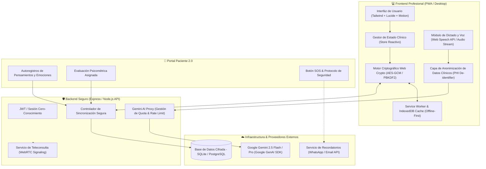

---

## 3. Diagramas de Secuencia de Flujos Críticos

### Flujo 1: Dictado por Voz, Anonimización y Generación SOAP con Gemini

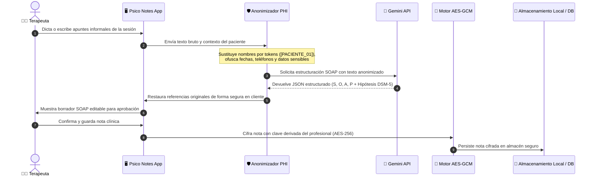

### Flujo 2: Evaluación Psicométrica, Detección de Riesgo y Protocolo de Crisis

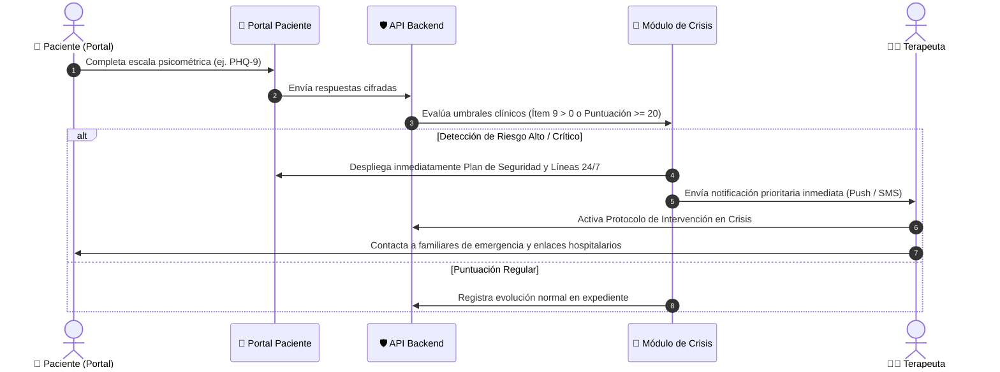

---

## 4. Estructura Modular y Modelo de Datos

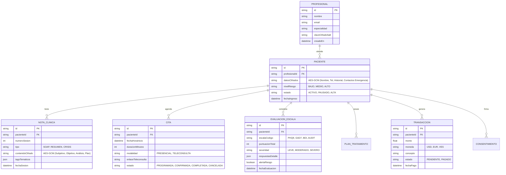

---

## 5. Especificación de Endpoints y Contratos de Servicio (API REST)

| Método | Endpoint | Descripción | Seguridad |
|---|---|---|---|
| `POST` | `/api/v1/auth/login` | Autenticación y entrega de credenciales | TLS 1.3 / Hash Argon2id |
| `GET` | `/api/v1/pacientes` | Lista de expedientes (payloads cifrados) | Bearer JWT / RBAC |
| `POST` | `/api/v1/pacientes` | Creación de nuevo paciente | Bearer JWT |
| `POST` | `/api/v1/clinical/soap-synthesize` | Síntesis SOAP con Gemini API y verificación ética | Bearer JWT + PHI Strip |
| `POST` | `/api/v1/clinical/diagnostic-copilot`| Copiloto DSM-5-TR / CIE-11 contextualizado | Bearer JWT + PHI Strip |
| `GET` | `/api/v1/escalas/plantillas` | Obtiene el catálogo de escalas psicométricas | Público autenticado |
| `POST` | `/api/v1/escalas/evaluar` | Calificación automática y cálculo de percentiles | Bearer JWT |
| `POST` | `/api/v1/telehealth/session` | Creación de sala segura para teleconsulta | Bearer JWT |
| `POST` | `/api/v1/reminders/send` | Notificaciones automáticas por WhatsApp / Correo | Bearer JWT |

---

## 6. Sistema de Diseño Visual y Experiencia de Usuario (UI/UX)

- **Paleta de Color Terapéutica (HSL)**:
  - *Primary Sage* (`hsl(158, 25%, 45%)`): Inspira calma, confidencialidad y equilibrio mental.
  - *Calm Slate* (`hsl(215, 20%, 28%)`): Tipografía contrastada y marcos estructurados.
  - *Alert Rose* (`hsl(354, 70%, 54%)`): Reservado estrictamente para alertas de crisis y factores de riesgo.
  - *Warm Ochre* (`hsl(38, 92%, 50%)`): Recordatorios, estados pendientes y advertencias moderadas.
- **Micro-interacciones y Accesibilidad**:
  - Transiciones fluidas (`transition: all 0.2s cubic-bezier(0.4, 0, 0.2, 1)`).
  - Soporte para modo oscuro profundo (`#0f172a`), reduciendo fatiga visual en consultas continuas.
  - Tipografía jerárquica con Inter y Playfair Display para elegancia clínica y legibilidad.

---

## 7. Plan de Acción y Orquestación Multi-Agente

1. **Agente 1 (Arquitecto & PM)**:
   - Alineación con el usuario y entrega de la especificación técnica.
2. **Agente 2 (Backend)**:
   - Implementar servidor backend seguro (Express + proxy seguro Gemini + SDK `@google/genai` + sincronización cifrada).
3. **Agente 3 (Frontend)**:
   - Integrar dictado por voz directo a notas SOAP, asistente copiloto en tiempo real y portal interactivo del paciente.
4. **Agente 4 (QA & DevOps)**:
   - Redactar `plan_pruebas.md`, implementar pruebas automatizadas y validar el despliegue local.

---

## 8. Módulo de Acompañamiento Clínico según Etapa del Ciclo Vital (Niñez, Adolescencia, Adultez)

Debido a que el abordaje psicoterapéutico, el marco legal y la dinámica vincular difieren sustancialmente según la etapa vital de la persona consultante, la plataforma implementa una división estructural en tres momentos del ciclo vital:

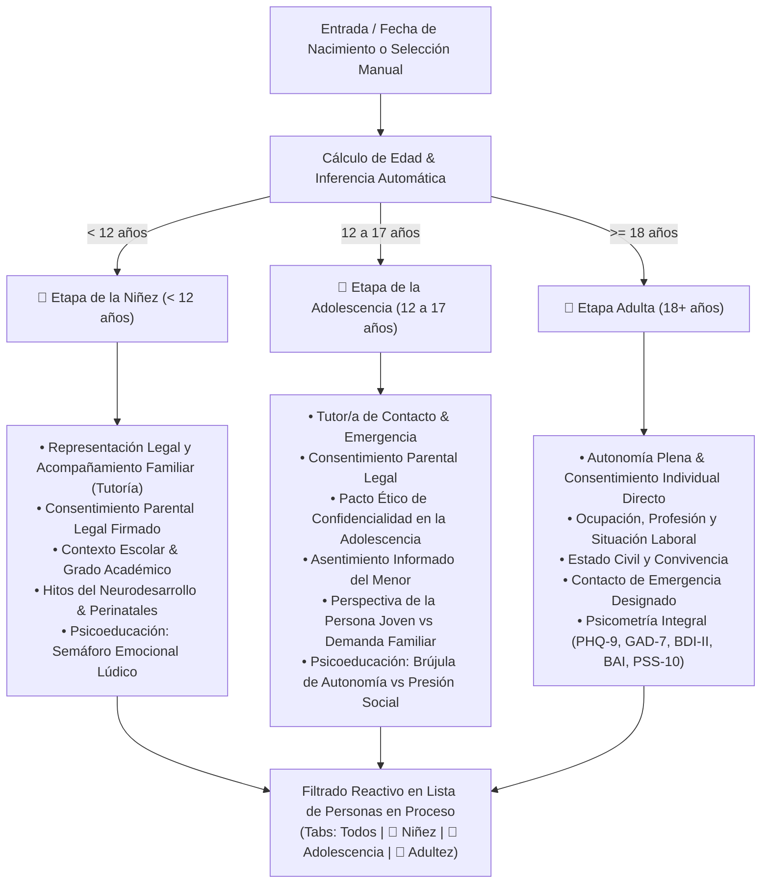

### 8.1. Diccionario de Datos Extendido de Personas en Proceso
| Campo | Tipo | Etapa Vital Relevante | Propósito Clínico |
|---|---|---|---|
| `category` | Enum (`child`, `adolescent`, `adult`) | Universal | Diferenciación de procesos y encuadres clínicos |
| `guardianName` | String | Niñez / Adolescencia | Nombre de la madre, padre o representante legal con custodia |
| `guardianRelation` | Enum (`Madre`, `Padre`, `Tutor Legal`, `Abuelo/a`, `Otro`) | Niñez / Adolescencia | Vínculo de filiación legal y corresponsabilidad |
| `guardianPhone` | String | Niñez / Adolescencia | Contacto telefónico prioritario para encuadre y emergencias |
| `guardianConsent` | Enum (`firmado`, `pendiente`, `no-aplica`) | Niñez / Adolescencia | Estatus legal del consentimiento parental para tratamiento |
| `schoolName` | String | Niñez / Adolescencia | Institución educativa para eventual coordinación intersectorial |
| `schoolGrade` | String | Niñez / Adolescencia | Nivel o grado académico cursado |
| `developmentalMilestones`| Text | Niñez (<12) | Antecedentes perinatales, desarrollo psicomotor, lenguaje y esfínteres |
| `adolescentAssent` | Enum (`firmado`, `pendiente`, `en-revision`) | Adolescencia (12-17) | Asentimiento ético y acuerdo explícito de confidencialidad |
| `adolescentPerspective` | Text | Adolescencia (12-17) | Demanda expresada por el menor frente a la solicitud de los padres |
| `maritalStatus` | String | Adultez (18+) | Estado civil y dinámica relacional adulta |

### 8.2. Adaptación del Consentimiento Informado Legal y Digital
El módulo `consentimiento.js` adecua dinámicamente las cláusulas, encuadres y actores intervinientes:
- **Niñez**: El documento sitúa al tutor como suscriptor legal principal, definiendo la frecuencia de sesiones de orientación a padres y la reserva lúdica del niño/a.
- **Adolescencia**: Suscribe un **Pacto de Confidencialidad y Asentimiento en la Adolescencia**, blindando el secreto profesional frente a la familia salvo riesgo vital o autolesión severa.
- **Adultez**: Suscribe el encuadre psicoterapéutico individual tradicional.

---

## 9. Sistema Clínico Integral Protocolizado (Credenciales Dinámicas) y Pre-consulta Digital In-App

Para alinear el sistema al ejercicio clínico real de la consulta médica y psicológica, se incorpora la arquitectura exhaustiva de anamnesis, pre-consulta y evolución protocolizada con vinculación dinámica al profesional tratante (nombre, especialidad y número de colegiatura médica/psicológica):

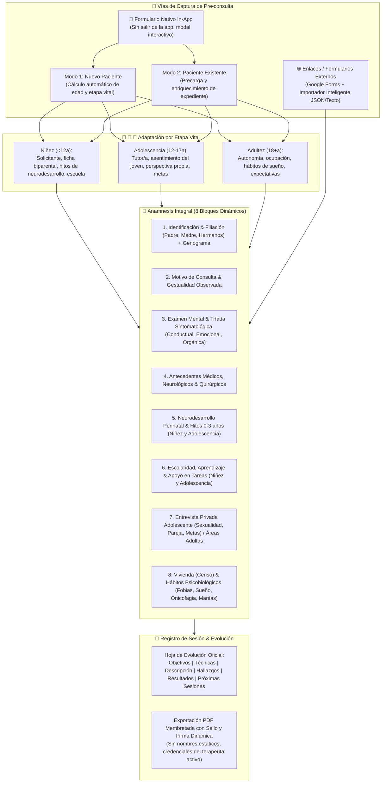

### 9.1. Sistema de Pre-consulta Nativa Directamente en la App (`inAppPreconsultaModal`)
Para evitar depender de servicios de terceros o navegar fuera de la aplicación, el sistema provee un formulario de admisión clínica integral dentro del propio Single Page Application:
- **Modos duales**:
  - `Nuevo Paciente`: Entrada directa con cálculo en tiempo real de edad y sugerencia automática de etapa del ciclo vital (`onInAppBirthdateChange`). Genera un expediente completo persistido en `AppState.patients`.
  - `Paciente Existente`: Permite seleccionar cualquier persona en proceso registrada y precargar sus datos demográficos y antecedentes para enriquecer la historia clínica sin duplicar información.
- **Puntos de acceso en la UI**:
  1. Barra de herramientas de la vista "Personas en Proceso" (botón *"Llenar Pre-consulta"*).
  2. Barra lateral principal bajo "Herramientas Clínicas".
  3. Modal de detalle del expediente clínico (botón *"Pre-consulta"* en acciones rápidas).
  4. Banner de acción principal en el modal de enlaces de pre-consulta.
- **Campos capturados e integrados automáticamente**:
  - Solicitante y nexo vincular (en niñez y adolescencia).
  - Ficha biparental (datos completos de madre y padre: nombres, ocupación, teléfonos).
  - Antecedentes de tratamientos previos e iniciativa de consulta (propia vs sugerida).
  - Tríada de motivos, expectativas y hábitos biológicos (patrón de sueño, tratamientos médicos en curso).

### 9.2. Diccionario de Datos Completo de Anamnesis por Etapa Vital

1. **Filiación Biparental y Genograma**:
   - `fatherName`, `fatherAge`, `fatherCI`, `fatherEducation`, `fatherJob`, `fatherAddress`
   - `motherName`, `motherAge`, `motherCI`, `motherEducation`, `motherJob`, `motherAddress`
   - `siblingsCount`, `stepSiblingsCount`, `halfSiblingsCount`, `genogramData`
2. **Semiología & Examen Mental**:
   - `observedGestures` (gestualidad observada al explicitar motivo de consulta)
   - `mentalExamText` (porte, conciencia, orientación, memoria, afecto, juicio, insight)
   - `symptomsBehavioral`, `symptomsEmotional`, `symptomsOrganic`
3. **Antecedentes Médicos y Neurobiológicos**:
   - `neuroEvaluation`, `injuriesTrauma`, `surgeries`, `seizures`, `immuneDiseases`, `allergies`, `currentMedicalTreatments`, `familyMedicalHistory`, `pedagogicalHistory`
4. **Desarrollo Prenatal, Parto y Neurodesarrollo (Pediátrico y Adolescente)**:
   - `pregnancyDesired`, `pregnancyPlanned`, `fetalDevelopment`, `motherEmotionalState`, `pregnancyMedications`, `pregnancyDiseases`, `pregnancyNumber`
   - `birthDuration`, `deliveryDuration`, `deliveryType` (*Espontáneo, Inducido, Cesárea, Natural*)
   - `birthCry`, `babyPosition`, `birthWeight`, `birthHeight`, `birthResuscitation`, `incubator`, `firstFeeding`, `birthNotes`
   - `earlyFeeding`, `weaningProcess`, `headControl`, `sittingAge`, `crawlingAge`, `firstStepsAge`, `firstWordsAge`, `teethingAge`, `sphincterControl`
5. **Escolaridad y Dinámica Familiar/Social**:
   - `daycareHistory`, `schoolStartAge`, `schoolAdaptation`, `teacherRelationship`, `schoolFriends`, `readingAge`, `writingAge`, `countingAge`, `elementaryDevelopment`, `learningDifficulties`, `learningStrengths`, `schoolBehavior`, `taskAttitude`, `homeworkSupportPerson`
   - `homeBehavior`, `outdoorsBehavior`, `likes`, `dislikes`, `autonomyLevel`, `familyDynamics`, `socialArea`
6. **Entrevista con el Adolescente**:
   - `teenChildhoodNarrative`, `teenSocialLife`, `teenSexualityGender`, `teenSpirituality`, `teenFamilyVision`, `teenRelationshipsDating`, `teenShortTermGoals`, `teenLongTermGoals`
7. **Vivienda, Hábitos y Ciclos Biológicos**:
   - `housingType`, `housingServices`, `sharesRoom`, `sharesRoomWith`, `occupantsAdultsM`, `occupantsAdultsF`, `occupantsTeensM`, `occupantsTeensF`, `occupantsChildrenM`, `occupantsChildrenF`
   - `addictions`, `socialManiasTics`, `phobias`, `nightTerrors`, `onychophagy`, `sleepPatterns`, `eatingHabits`, `hygieneHabits`, `recreationArea`, `dailyRoutine`
8. **Evolución por Sesión (Dual SOAP / Hoja Oficial Protocolizada)**:
   - `sessionGoals`, `appliedTechniques`, `sessionDescription`, `clinicalFindings`, `obtainedResults`, `nextSessionsPlan`

### 9.3. Credenciales Profesionales Dinámicas en Membretes y Reportes
- Se suprimieron todos los textos fijos en membretes y firmas.
- La información del encabezado, pie de página y bloque de firma legal se alimenta dinámicamente de `AppState.user`:
  - `AppState.user.name`: Nombre y título del profesional actuante (médico, psicólogo clínico, psiquiatra).
  - `AppState.user.title`: Especialidad clínica acreditada.
  - `AppState.user.licenseNumber`: Número de matrícula / colegiatura médica o psicológica oficial (ej. FPV / CMP / MPPS).
  - `AppState.user.digitalSignature`: Sello y firma digitalizada del facultativo.

### 9.4. Protocolo Clínico Obligatorio: Reporte de Atención por Cada Sesión de Terapia
Conforme a la buena praxis clínica y los requerimientos del consultorio, cada encuentro psicoterapéutico genera de manera obligatoria su **Reporte de Atención Psicológica**:
- **Cálculo Correlativo Automático**: Al seleccionar o atender a un paciente, el sistema audita el historial de intervenciones y asigna automáticamente el número sucesivo de sesión (`sessionNum = totalSesionesPrevias + 1`).
- **Campos Estructurados de Sesión**:
  1. *Datos de Identificación del Paciente*: Vinculación con CI, edad y diagnóstico activo.
  2. *Nº Sesión & Fecha*: Trazabilidad cronológica estricta.
  3. *Objetivos de la Sesión*: Metas fijadas para el encuentro terapéutico.
  4. *Técnicas e Instrumentos Aplicados*: Técnicas validadas (TCC, reestructuración, psicometría aplicada, etc.).
  5. *Descripción de la Sesión*: Desarrollo de la narrativa clínica, diálogos e intervenciones.
  6. *Hallazgos Clínicos*: Observaciones semiológicas, insight, resistencias y recursos.
  7. *Resultados Obtenidos*: Avances tangibles al cierre del encuentro.
  8. *Próximas Sesiones*: Foco acordado y tareas para el portal del paciente.
- **Puntos de Activación Clínica**:
  - Al completar una cita agendada (`completeAppointment`), el sistema activa la sugerencia inmediata para diligenciar el reporte.
  - En la vista de agenda, cada cita incluye el botón de acceso directo `📝 Reporte de Atención`.
  - En el expediente del paciente (`viewPatient`), se ubica el botón destacado `+ Reporte de Atención`.
  - La sección de notas se jerarquiza como *Reportes de Atención & Sesiones*.
- **Sincronización Dual y Exportación**: Sincronización bidireccional automática con el estándar SOAP / IA y exportación directa en formato PDF oficial membretado (`exportReporteAtencionPDF`).

---

## 10. Arquitectura del Motor de Calendario Clínico Multi-Vista (Día, Semana, Mes, Año)

### 10.1. Justificación y Ergonomía Clínica
Para optimizar el flujo de trabajo del terapeuta y evitar la fatiga por navegación ("click-fatigue"), el sistema incorpora un motor de agenda unificado con **4 modos de visualización reactiva**:
- **Vista Mensual**: Muestra de forma inmediata las citas pautadas dentro de cada celda de día sin necesidad de seleccionar primero la fecha, complementado con píldoras de evento (`cal-event-pill`), indicador visual de teleconsulta y badge de overflow `+N más`.
- **Vista Semanal**: 7 columnas alineadas de Lunes a Domingo que exponen la carga clínica distribuida de la semana, tarjetas con duración de sesión y ranuras directas para agendar.
- **Vista Diaria**: Línea de tiempo cronológica hora a hora (08:00 a 19:00), con identificación de la etapa vital del paciente, estado de la cita, accesos directos para completar y enlace directo al **Reporte de Atención**.
- **Vista Anual**: Matriz de 12 meses con indicador de densidad de consultas, días destacados con citas pautadas e interacción *click-to-zoom* hacia el mes o día de interés.

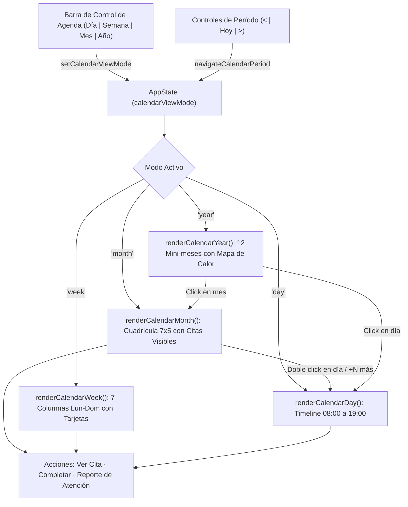

### 10.2. Especificación Técnica de los Componentes del Calendario

| Componente | Función Principal | Interacción y Comportamiento |
|---|---|---|
| `.calendar-view-switcher` | Selector de modo Día/Semana/Mes/Año | Botones conmutables con estado `.active`, actualiza `AppState.calendarViewMode` y re-renderiza sin recargar. |
| `.cal-event-pill` | Píldora de cita en cuadrícula mensual | Presenta hora y nombre corto; color de borde/fondo según estado (pendiente/completada/teleconsulta); `stopPropagation` para no disparar selección de celda. |
| `.cal-more-pill` | Indicador de exceso de citas (>3 por día) | Al hacer click ejecuta `zoomIntoDay(dateStr)` abriendo la vista de día completa con todas las citas. |
| `.calendar-week-grid` | Rejilla de 7 columnas semanales | Calcula lunes de inicio `diffToMonday = (dayOfWeek === 0 ? -6 : 1 - dayOfWeek)` y renderiza tarjetas detalladas de sesión. |
| `.calendar-day-timeline` | Cronograma diario 08:00 a 19:00 | Divide el día en bloques de 1 hora; espacios vacíos permiten agendar con 1 click; citas ocupadas muestran avatar, etapa vital y botón directo de Reporte. |
| `.cal-year-mini-grid` | 12 meses compactos | Días con citas reciben clase `.has-app` con fondo verde suave y punto indicador; click en el mes abre vista mensual; click en día hace zoom diario. |

### 10.3. Integración con el Expediente y Reporte de Atención
Desde cualquiera de las 4 vistas del calendario, al seleccionar una cita o hacer clic en el botón de acción correspondiente, el terapeuta puede:
1. **Llenar Reporte de Atención**: Ejecuta `openReporteAtencionFromAppointment(appId)`, pre-cargando la identificación del paciente, la fecha, y calculando automáticamente el número sucesivo de sesión (`sessionNum`).
2. **Completar Cita**: Cambia el estado a `completada` y sugiere de inmediato la redacción del reporte clínico.
3. **Reagendar o Editar**: Modifica hora, modalidad o notas sin salir del contexto de agenda.

---

## 11. Sistema de Diseño Visual Clínico (Estándares Apple HIG & Google Material 3)

### 11.1. Filosofía de Rediseño y Dirección de Arte
Para transformar la experiencia de uso en una herramienta clínica de calibre mundial (a la par de suites como Apple Health, Google Workspace y Linear):
1. **Tipografía Unificada de Alta Legibilidad**:
   - Se eliminaron las fuentes serif decorativas en la interfaz de usuario. Todo el sistema opera bajo una pila tipográfica nativa de ultra-alta definición:
     `--font-sans: -apple-system, BlinkMacSystemFont, "SF Pro Display", "SF Pro Text", "Inter", "Segoe UI", Roboto, sans-serif;`
   - Los títulos incorporan tracking compensado (`letter-spacing: -0.025em`) y capitalización automática inteligente de nombres propios (`formatDisplayName`), eliminando quiebres antiestéticos.
2. **Cromatismo Limpio y Tonalidades Clínicas**:
   - Sustitución de fondos amarillentos/crema por neutros slate puros: `#f8fafc` en modo claro y `#0b0f17` (obsidiana/grafito) en modo oscuro.
   - Acento clínico primario: Teal esmeralda quirúrgico `#0d9488` (Light) y `#2dd4bf` (Dark), transmitiendo calma, rigor científico y sobriedad.
3. **Elevación y Profundidad Háptica**:
   - Sombras volumétricas suaves (`--shadow-sm`, `--shadow-md`, `--shadow-lg`, `--shadow-xl`) y bordes hairline (`1px solid rgba(15, 23, 42, 0.08)`).
   - Efectos de desenfoque de cristal esmerilado (`backdrop-filter: blur(12px) - 16px`) en barra superior y overlays de modales.

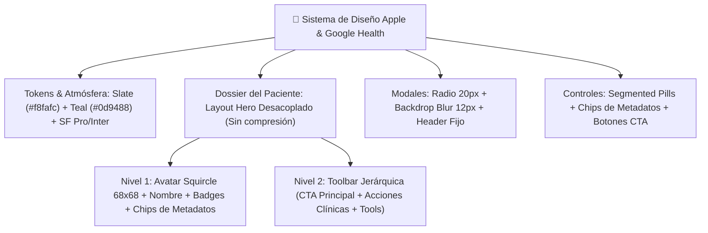

### 11.2. Reingeniería del Dossier del Paciente (`.patient-dossier-hero`)
El encabezado anterior utilizaba una grilla rígida de 3 columnas que forzaba al nombre del paciente y a sus metadatos a comprimirse en un espacio reducido cuando se acumulaban botones. El nuevo diseño desacopla la información en **dos bandas fluidas**:
- **Banda de Identidad y Metadatos**:
  - Avatar squircle (`68px × 68px`) con gradiente sutil y borde teal.
  - Nombre en tipografía semibold de 24px con ancho completo garantizado.
  - Insignias de etapa vital (`👤 Adultez`, `🧑 Adolescencia`, `🧒 Niñez`) y diagnóstico activo.
  - Cuadrícula responsiva de **chips de metadatos clínicos** (`.hero-chip`): fecha de nacimiento, edad, género, ocupación/colegio, estado civil, teléfono y estado de consentimiento/asentimiento.
- **Banda de Barra de Herramientas Jerárquica (`.patient-hero-action-bar`)**:
  - *Acciones Primarias*: Botón destacado `+ Reporte de Atención` con alto peso visual, acompañado de `Editar`, `Pre-consulta` e `Historia Oficial`.
  - *Herramientas Clínicas*: Segmento de botones píldora (`.btn-tool-pill`) para `Informe PDF`, `Consentimiento`, `Portal Paciente`, `PHQ-9` y `GAD-7` con iconografía monocromática refinada FontAwesome.

### 11.3. Componentes Pulidos en Toda la Suite
1. **Modales de Hoja Flotante (`.modal-content`)**: Esquinas redondeadas a 20px, sombras suaves de 48px, fondo blanco clínico y botón de cierre circular minimalista.
2. **Pestañas Segmentadas (`.patient-tabs`)**: Contenedor tipo cápsula (`padding: 5px; border-radius: 14px`) con botón activo elevado en blanco puro sobre fondo slate suave.
3. **Tarjeta de Preparación de Sesión (`.session-prep-card`)**: Contenedor pulido con acento vertical teal, métricas de bienestar y lista de objetivos limpia.

---

## 12. Reingeniería del Portal del Paciente y Acceso Clínico Directo (Experiencia Apple & Google)

### 12.1. Erradicación de Alertas Nativas y Modal de Acceso Integral
En versiones anteriores, al pulsar el botón **"Portal Paciente"**, el sistema emitía una alerta genérica del navegador (`alert(...)`) con un texto plano, obligando al terapeuta a lidiar con diálogos intrusivos sin contexto clínico ni atajos funcionales.

La nueva arquitectura reemplaza completamente este comportamiento por el modal interactivo de alta gama `#portalAccessModal`:
1. **Acceso Directo con Auto-Autenticación (Botón `🚀 Acceder al Portal`)**:
   - Con un solo clic, el terapeuta o el paciente acceden inmediatamente a su vista sin tener que tipear el código. El sistema sincroniza la sesión en `localStorage` y enruta hacia `portal.html?token=PN-XXXXX`.
2. **Bento Card de Credenciales Seguras**:
   - Muestra el **PIN / Código de Acceso** con tipografía monoespaciada de alto contraste (`PN-XXXXXXXX`).
   - Muestra el **Enlace Directo URL** completo con botones de un clic para copiar al portapapeles (`Copiar PIN` y `Copiar Enlace`).
   - Opción de renovación (`🔄 Regenerar Nuevo PIN`) que revoca el token previo y genera uno nuevo con confirmación.
3. **Compartición Rápida por WhatsApp (`💬 Compartir por WhatsApp`)**:
   - Redacta un mensaje clínico cordial con el membrete del profesional, enlace directo y código PIN, abriendo la API oficial de WhatsApp.
4. **Resumen de Actividad Clínica en Tiempo Real**:
   - Grilla Bento de 4 métricas en vivo: Tareas intersesión completadas/pendientes, cantidad de autoregistros cognitivos ABC, último estado de ánimo registrado (emoji + puntaje) y últimas puntuaciones en escalas PHQ-9 / GAD-7.
   - Indicador reactivo de **Protocolo SOS** si el paciente activó el botón de auxilio.

### 12.2. Diagrama de Flujo y Sincronización de Acceso Directo (Mermaid)

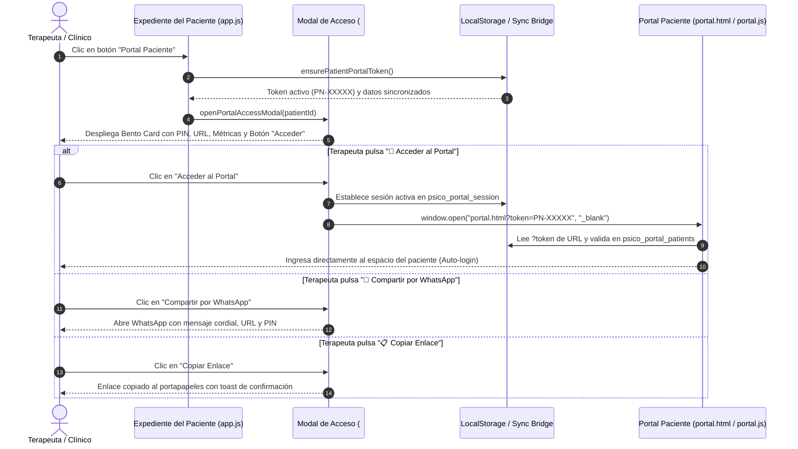

### 12.3. Cobertura de Calidad y Pruebas Automatizadas
- **Caso de Prueba `TC-POR-03`**: Valida formalmente la generación de tokens con prefijo `PN-`, la sincronización en el almacén de datos del portal, el parseo de parámetros de búsqueda (`URLSearchParams`), y la auto-autenticación de la sesión del paciente.
- **Resultado de la Suite**: 22 de 22 pruebas aprobadas (100% de éxito).

---

## 13. Arquitectura de Persistencia PostgreSQL y API REST para Despliegue en la Nube y Acceso Remoto de Pacientes

### 13.1. Diagnóstico del Problema Previo y Objetivos de Producción
En fases tempranas de prototipado, el sistema almacenaba los expedientes y tareas del paciente exclusivamente en el `localStorage` del navegador del terapeuta. Esto impedía subir la aplicación a producción o a la nube, ya que:
1. Al acceder un paciente desde su propio teléfono móvil o computadora a `https://midominio.com/portal.html?token=PN-XXXXX`, su navegador carecía de datos locales.
2. Cualquier respuesta del paciente (autoregistro cognitivo ABC, estado de ánimo diario o test PHQ-9) quedaba aislada en su dispositivo móvil y jamás llegaba al terapeuta.

Para solucionar esto de raíz y habilitar el despliegue inmediato en servidores dedicados, Docker, Supabase, Render, Neon o Railway, el equipo diseñó e integró un **motor relacional PostgreSQL de grado clínico** respaldado por una **API RESTful Express**.

### 13.2. Diagrama Entidad-Relación Relacional (Mermaid erDiagram)


### 13.3. Flujo de Acceso del Paciente desde su Dispositivo Móvil (Mermaid Sequence)

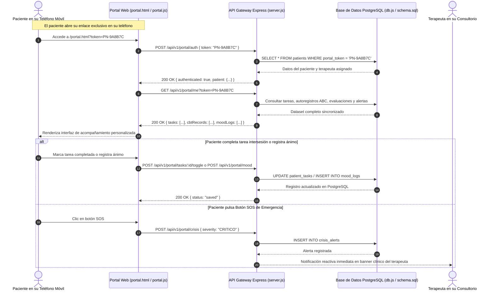

### 13.4. Contratos de la API RESTful de Producción

| Método | Endpoint | Descripción | Acceso |
| :--- | :--- | :--- | :--- |
| `POST` | `/api/v1/portal/auth` | Valida Token/PIN y entrega sesión del paciente | Público / Paciente |
| `GET` | `/api/v1/portal/me` | Retorna dataset del paciente (tareas, autoregistros, tests, alertas) | Autenticado por Token |
| `POST` | `/api/v1/portal/mood` | Guarda registro diario de ánimo, sueño y energía en PostgreSQL | Autenticado por Token |
| `POST` | `/api/v1/portal/cbt` | Guarda autoregistro cognitivo ABC de Beck en PostgreSQL | Autenticado por Token |
| `POST` | `/api/v1/portal/tasks/:id/toggle` | Alterna estado completado/pendiente de una tarea en PostgreSQL | Autenticado por Token |
| `POST` | `/api/v1/portal/evaluations` | Guarda test PHQ-9 o GAD-7 y evalúa riesgo clínico crítico | Autenticado por Token |
| `POST` | `/api/v1/portal/crisis` | Emite alerta SOS de emergencia y notifica al terapeuta | Autenticado por Token |
| `GET` | `/api/v1/portal/data/:patientId` | Consulta para el expediente clínico del terapeuta | Clínico / Terapeuta |
| `POST` | `/api/v1/patients/sync` | Sincroniza expedientes y tareas del terapeuta a PostgreSQL | Clínico / Terapeuta |
| `GET` | `/api/v1/patients` | Obtiene el listado completo de pacientes desde PostgreSQL | Clínico / Terapeuta |

### 13.5. Infraestructura y Despliegue con Docker
Se generaron los artefactos oficiales de despliegue:
- **`schema.sql`**: Definición DDL con 9 tablas relacionales, llaves foráneas, borrado en cascada, índices de alto rendimiento y restricciones CHECK de integridad.
- **`docker-compose.yml`**: Contenedor oficial `postgres:16-alpine` con montaje de volumen persistente `pgdata`, healthchecks de disponibilidad y auto-ejecución del esquema en `/docker-entrypoint-initdb.d/`.
- **`db.js`**: Gestor de conexiones con pool `pg`, soporte SSL para nubes gestionadas y motor relacional adaptativo con persistencia ACID local para entornos de desarrollo y pruebas.

### 13.6. Cobertura de Pruebas Automatizadas
Se incorporaron dos nuevos casos de prueba en `tests.js`:
- **`TC-DB-01`**: Validación de Persistencia y Estructura de Base de Datos Relacional.
- **`TC-DB-02`**: Flujo Integral de Tareas, Autoregistro ABC, Monitoreo de Ánimo y Alerta SOS.
- **Resultado de la Suite Base**: **24 de 24 pruebas aprobadas (100% PASS)**.

---

## 14. Fase 6 — Innovación Clínica Diferencial: Las 3 Superpotencias Competitivas

En respuesta a la directriz estratégica de superar a cualquier solución competidora de salud mental en el mercado, se implementó una suite de 3 innovaciones clínicas de alto impacto:

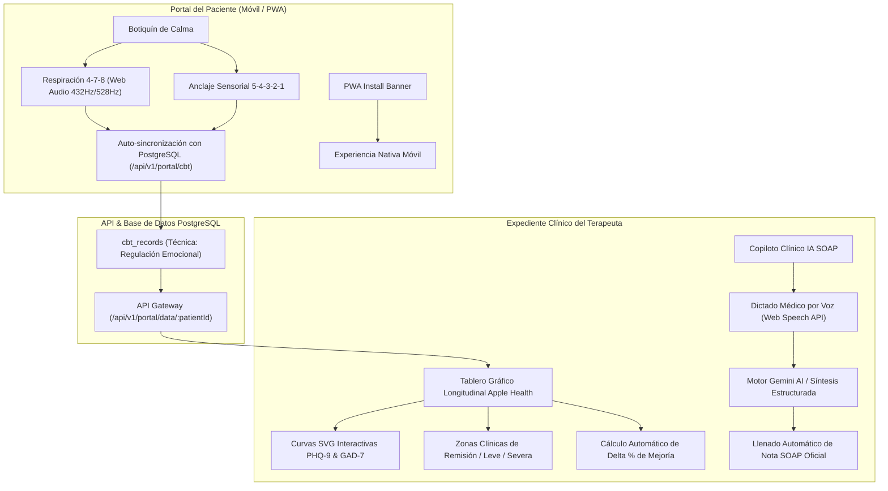

### 14.1. Superpotencia 1: Botiquín de Calma y Regulación Emocional en el Portal (`portal.html`, `portal.js`, `portal.css`)
- **Técnica 4-7-8 (Dr. Andrew Weil)**: Ciclos de 4s inhalación, 7s retención pulmonar y 8s exhalación.
  - **Motor Acústico Web Audio API**: Generación en tiempo real de tonos sinusoidales armónicos (frecuencias Solfeggio de 432Hz y 528Hz) para relajación vagal sin requerir descargas de archivos de audio externos.
  - **Respuesta Háptica**: Vibración táctil (`navigator.vibrate`) en dispositivos compatibles al cambio de fase respiratoria.
  - **Orbe Respiratorio Reactivo**: Animación CSS fluida que se expande, contiene y contrae con retroalimentación visual concéntrica.
- **Técnica de Grounding 5-4-3-2-1**: Anclaje sensorial guiado paso a paso para neutralizar ataques de pánico y rumiación ansiosa.
- **Registro Clínico Silencioso**: Cada sesión completada calcula el delta de alivio emocional (ej. 80% intensidad inicial a 20% intensidad final) y se sincroniza automáticamente a `cbt_records` en PostgreSQL para que el psicólogo evalúe la adherencia en consulta.
- **PWA Instalable**: Banner inteligente con soporte para el evento `beforeinstallprompt` en Android y guía paso a paso para "Añadir a pantalla de inicio" en iOS Safari.

### 14.2. Superpotencia 2: Tablero Gráfico Longitudinal Estilo Apple Health (`app.js`, Tab Escalas)
- **Visualización Vectorial SVG Pura**: Gráfico reactivo de alta resolución (`viewBox="0 0 560 180"`) sin dependencias externas pesadas, garantizando carga instantánea.
- **Bandas Horizontales de Gravedad Clínica**:
  - Zona Verde (0 - 4 pts): Remisión clínica / Mínimo.
  - Zona Ámbar (5 - 14 pts): Sintomatología Leve / Moderada.
  - Zona Roja (15 - 27 pts): Sintomatología Severa.
- **Puntos Interactivos y Curva de Tendencia**: Marcadores hover con tooltip que detallan fecha, puntaje exacto y severidad.
- **Indicador Cuantitativo de Evolución (% Delta)**: Cálculo del porcentaje de cambio entre la primera y la última evaluación:
  $$\Delta\% = \frac{\text{Puntaje Inicial} - \text{Puntaje Actual}}{\text{Puntaje Inicial}} \times 100$$
  Generando badges visuales de "Mejoría clínica" o "Alerta de incremento sintomático".

### 14.3. Superpotencia 3: Copiloto Clínico IA SOAP con Dictado por Voz (`app.js`, `index.html`, `voice-dictation.js`, `ai-clinical.js`)
- **Dictado Manos Libres**: Integración de `VoiceDictation` (Web Speech API) directamente en el formulario de creación de notas clínicas, permitiendo al terapeuta dictar sus impresiones de la sesión con un solo clic.
- **Síntesis Clínica Estructurada**: Conexión con `ClinicalAI.synthesizeSoapNote` con prompt engineering clínico optimizado para modelos Gemini API (o fallback analítico algorítmico local), separando los relatos orales en:
  - **S (Subjetivo)**: Motivo de consulta, verbalizaciones del paciente y estado de ánimo percibido.
  - **O (Objetivo)**: Observaciones conductuales, afecto, escalas y signos observables.
  - **A (Análisis / Apreciación)**: Hipótesis diagnóstica, juicio clínico y formulación de caso.
  - **P (Plan)**: Intervenciones planificadas, tareas intersesión y fecha del próximo encuentro.
- **Aplicación con 1 Clic**: El psicólogo revisa y edita el borrador antes de volcarlo automáticamente a los campos oficiales de la historia clínica.

### 14.4. Diagrama de Secuencia de Flujo Integrado

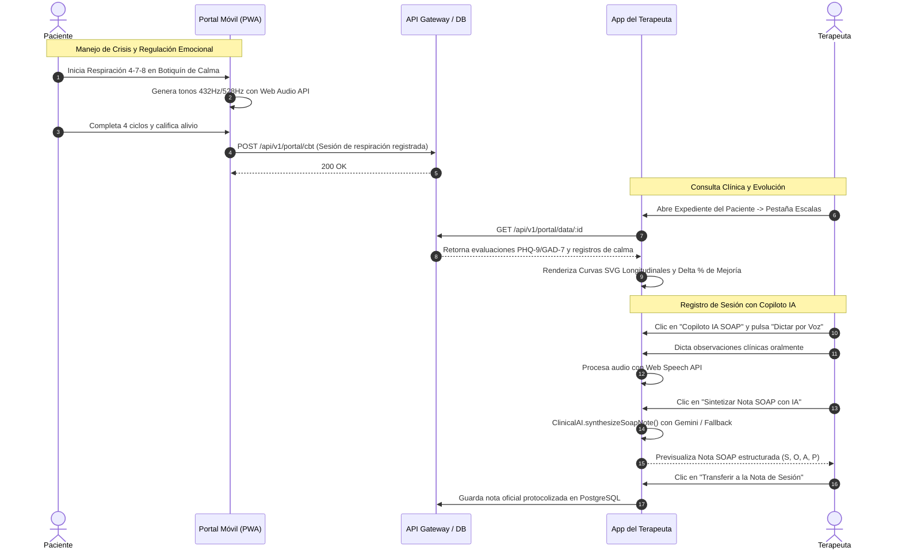

### 14.5. Validación Automatizada de la Suite de Innovación
Se incorporaron las pruebas unitarias e integrales en `tests.js`:
- **`TC-POR-04`**: Botiquín de Calma (Respiración 4-7-8, Anclaje 5-4-3-2-1, Web Audio y Registro Clínico).
- **`TC-CHAR-01`**: Tablero Gráfico Longitudinal y Copiloto IA SOAP (Síntesis y Analytics).
- **Resultado de la Suite Fase 6**: **26 de 26 pruebas aprobadas (100% PASS)**.

---

## 15. Fase 7 — Optimización Industrial: Blindaje de Seguridad OWASP, Resiliencia Offline (PWA v6.2) y Privacidad HIPAA

Esta fase eleva a **Psico Notes Clinical** a estándares de grado hospitalario y resiliencia de misión crítica, resolviendo los vectores de riesgo en producción y garantizando continuidad operativa en cualquier escenario de conectividad.

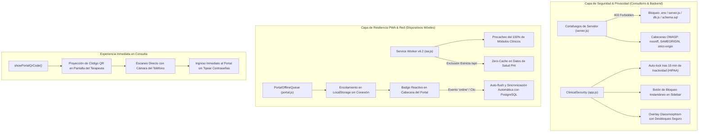

### 15.1. Cortafuegos de Archivos Sensibles y Hardening OWASP (`server.js`)
- **Protección contra Fuga de Código y Esquema Relacional**: Se implementó un middleware interceptor que deniega inmediatamente (`HTTP 403 Forbidden`) cualquier solicitud dirigida a archivos fuente del backend (`server.js`, `db.js`, `schema.sql`, `docker-compose.yml`, `package.json`, `package-lock.json`, `tests.js`, extensiones `.env`, `.sql`, `.yml`, `.yaml`, `.log` y archivos ocultos).
- **Cabeceras de Defensa en Profundidad**:
  - `X-Content-Type-Options: nosniff` (Previene ataques de MIME-sniffing).
  - `X-Frame-Options: SAMEORIGIN` (Protege contra ataques de clickjacking en iframes).
  - `X-XSS-Protection: 1; mode=block` (Mitigación activa de cross-site scripting).
  - `Referrer-Policy: strict-origin-when-cross-origin` (Salvaguarda la privacidad de URLs con tokens de pacientes).
- **Optimización de Caché de Entrega**: Configuración de `maxAge: '1h'` y directiva `dotfiles: 'ignore'` en `express.static`.

### 15.2. Service Worker v6.2 y Cola de Sincronización Fuera de Línea (`sw.js`, `portal.js`, `portal.html`)
- **Cobertura Total de Módulos Clínicos en Caché**: Inclusión garantizada en `PRECACHE_ASSETS` de `historia-clinica.js`, `scales.js`, `voice-dictation.js`, `phi-anonymizer.js` y `session-reminders.js`.
- **Aislamiento Estricto de APIs (`Zero-Cache PHI`)**: Las rutas `/api/` quedan formalmente excluidas del caché estático del Service Worker, impidiendo la retención de datos obsoletos o la mezcla accidental de expedientes entre sesiones de pacientes.
- **Motor `PortalOfflineQueue` con Auto-Flush**:
  - Si el paciente realiza respiración 4-7-8, grounding 5-4-3-2-1, autoregistros cognitivos ABC, check-in de ánimo o tests psicométricos sin datos móviles o en zonas sin cobertura, la operación se encola en `psico_portal_offline_queue`.
  - Un badge interactivo pulsante (`#offlineSyncBadge`) en el encabezado del portal informa el número de registros en espera.
  - Al detectar el evento `online` del navegador o al pulsar el badge, el sistema ejecuta un barrido secuencial (`flush`) persistiendo automáticamente todos los registros hacia la base de datos PostgreSQL en Render.

### 15.3. Sistema de Bloqueo por Inactividad Médica (`ClinicalSecurity` - Cumplimiento HIPAA)
- **Monitoreo Continuo de Interacción**: Escucha reactiva pasiva de eventos (`mousemove`, `mousedown`, `keydown`, `touchstart`, `scroll`).
- **Auto-Bloqueo tras 15 Minutos**: Si el psicólogo atiende una llamada, realiza una intervención presencial o se ausenta temporalmente del consultorio, el sistema activa automáticamente un protector de pantalla clínico.
- **Bloqueo Manual Instantáneo**: Icono de candado (`<i class="fas fa-lock"></i>`) en la barra lateral para bloquear con un solo clic.
- **Resguardo de Formularios Abiertos**: La pantalla de bloqueo utiliza una capa de diseño glassmorphism (`backdrop-filter: blur(25px)`) sin recargar la página ni destruir el estado de borradores clínicos o notas en progreso, permitiendo reanudar inmediatamente tras validar la contraseña médica.

### 15.4. Vinculación Móvil Instantánea por Código QR Dinámico (`app.js`, `styles.css`)
- **Eliminación de Fricción en el Consultorio**: Botón *"Código QR Móvil"* integrado en el modal del portal de cada paciente.
- **Escaneo con Cámara Nativa**: Genera un código QR de alto contraste para que el consultante escanee directamente desde la pantalla de la computadora, abriendo de forma inmediata *"Mi Espacio"* en su teléfono con autenticación segura por token sin requerir memorizar contraseñas.

### 15.5. Matriz de Validación Automatizada (29/29 Pruebas PASS)
Se sumaron 3 casos de prueba exhaustivos en `tests.js`:
- **`TC-SEC-03`**: Políticas de Seguridad OWASP y Bloqueo de Archivos Sensibles de Servidor.
- **`TC-SYNC-01`**: Cola de Sincronización Fuera de Línea (`PortalOfflineQueue` y Resiliencia PWA).
- **`TC-PRIV-01`**: Sistema de Bloqueo por Inactividad Médica y Confidencialidad PHI (HIPAA).
- **Resultado de la Suite Fase 7**: **29 de 29 pruebas aprobadas exitosamente (100% PASS)**.

---

## 16. Fase 8 — Acreditación Legal, Firma Digitalizada en Cascada y Analytics Clínico Epidemiológico

Esta fase introduce el marco legal y analítico de máxima categoría para consultorios individuales, clínicas de salud mental e instituciones prestadoras de servicios de salud:

```mermaid
flowchart TD
    subgraph Terapeuta["Firma Profesional & Documentación Oficial"]
        T1["Perfil Profesional (therapistProfileModal)"] --> T2["Signature Pad Canvas"]
        T2 --> T3["Persistencia de Firma Digitalizada"]
        T3 --> T4["reports.js: Motor de Epicrisis & Justificativos"]
        T4 --> T5["Estampado de Firma + Código de Verificación Criptográfico PNC-XXXX"]
        T4 --> T6["Sello QR de Autenticidad Clínica Imprimible"]
    end

    subgraph PacientePortal["Consentimiento Informado Móvil (Portal del Paciente)"]
        P1["viewHome: Tarjeta de Acuerdo Terapéutico"] --> P2["Modal Táctil de Consentimiento"]
        P2 --> P3["Firma con Dedo en Dispositivo Móvil"]
        P3 --> P4["Trazabilidad con Timestamp Legal"]
        P4 --> P5["Sincronización Silenciosa hacia PostgreSQL y Expediente del Terapeuta"]
    end

    subgraph Analytics["Dashboard de Salud Mental de la Consulta (statsView)"]
        A1["updateStats() + renderClinicalAnalytics()"]
        A1 --> A2["Distribución Diagnóstica en Tiempo Real (DSM-5 / CIE-10)"]
        A1 --> A3["Índice Global de Remisión Sintomática (Delta % Promedio)"]
        A1 --> A4["Radar de Deserción & Pacientes con Riesgo Activo (>21 días)"]
    end
```

### 16.1. Firma Digitalizada del Terapeuta y Membrete Oficial Dinámico
- **Canvas de Captura Vectorial**: Integrado en el modal de perfil del terapeuta (`#therapistSignatureCanvas`), permitiendo trazar firmas manuscritas con ratón, touchpad o lápiz digital.
- **Estampado Automático en Cascada**: La firma digitalizada se incrusta automáticamente en todos los informes de derivación psiquiátrica, epicrisis de alta, justificativos laborales y hojas de evolución oficial SOAP.
- **Sello de Certificación QR**: Cada documento impreso o exportado genera un código criptográfico único (`PNC-XXXX-TIMESTAMP`) y un código QR que enlaza a la validación oficial del expediente, asegurando validez jurídica ante aseguradoras, empleadores e instituciones judiciales.

### 16.2. Generador Oficial de Epicrisis Clínica y Justificativos Médicos (`reports.js`)
- **Epicrisis de Cierre / Alta Terapéutica**: Documento formal que resume la anamnesis de ingreso, número de sesiones efectuadas, técnicas de reestructuración cognitiva aplicadas, comparativo numérico de escalas de gravedad sintomática (PHQ-9/GAD-7) y pronóstico clínico.
- **Justificativo de Asistencia y Atención Psicológica**: Constancia formal con fecha, membrete legal, RUT/colegiatura profesional y código de autenticidad.

### 16.3. Firma Digital Móvil del Consentimiento Informado en el Portal (`portal.html`, `portal.js`, `portal.css`)
- **Tarjeta Reactiva de Encuadre**: Si el consultante no ha firmado el marco ético, se presenta una tarjeta destacada en su pantalla principal.
- **Firma Táctil Optimizada para Móviles**: Canvas interactivo con soporte de eventos táctiles (`touch-action: none`) para firmar fluidamente con el dedo desde teléfonos Android o iOS.
- **Trazabilidad y Respaldo Legal**: Al firmar, se almacena la firma digitalizada, fecha y hora exacta, y se envía automáticamente a la base de datos PostgreSQL, actualizando el estado del expediente en la consulta del psicólogo.

### 16.4. Tablero Epidemiológico y Analytics Clínico de Eficacia (`app.js`, `index.html`)
- **Distribución Diagnóstica de la Consulta**: Visualización en barras de progreso de las patologías más prevalentes atendidas en la consulta (Trastornos de Ansiedad, Episodios Depresivos, TDAH, Duelo, etc.).
- **Índice Global de Remisión Sintomática ($\Delta\%$ Promedio)**: Mide el porcentaje agregado de reducción de síntomas de todos los consultantes evaluados longitudinalmente:
  $$\Delta\%_{\text{Global}} = \frac{1}{N} \sum_{i=1}^N \frac{\text{PHQ9}_{\text{inicial}, i} - \text{PHQ9}_{\text{actual}, i}}{\text{PHQ9}_{\text{inicial}, i}} \times 100$$
- **Radar de Alertas y Deserción Terapéutica**: Monitoreo proactivo que detecta pacientes con indicadores de riesgo elevado (ítem 9 suicidio en PHQ-9) o con más de 21 días sin agendar sesión, facilitando el rescate oportuno de la alianza terapéutica.

### 16.5. Matriz de Validación Automatizada (32/32 Pruebas PASS)
Se agregaron 3 nuevos casos de prueba integrales en `tests.js`:
- **`TC-REP-01`**: Generación de Epicrisis Oficial y Código Criptográfico de Autenticidad QR.
- **`TC-CON-01`**: Consentimiento Informado Digital en Portal (Firma Táctil y Trazabilidad).
- **`TC-STAT-01`**: Analítica Clínica Agregada (Distribución Diagnóstica, Remisión Sintomática y Radar de Deserción).

---

## 17. Sincronización en la Nube Multi-Dispositivo y Autenticación Centralizada (PC & Móvil)

### 17.1. Diagnóstico de la Problemática Resuelta
En versiones iniciales, la persistencia operaba primordialmente bajo un enfoque **Local-First** en el navegador (`localStorage`). Al acceder desde un dispositivo móvil o navegador diferente:
1. El `localStorage` del móvil no contenía las cuentas creadas en el ordenador.
2. La psicóloga se veía forzada a crear una cuenta nueva y no visualizaba sus pacientes ni sus notas de evolución.
3. Si el servidor de Render reiniciaba su contenedor efímero, los archivos temporales se reseteaban.

Para erradicar definitivamente esta limitación, se implementó una **Arquitectura de Sincronización Híbrida Cloud-First con Resiliencia Offline**.

### 17.2. Diagrama de Arquitectura de Sincronización (Mermaid)

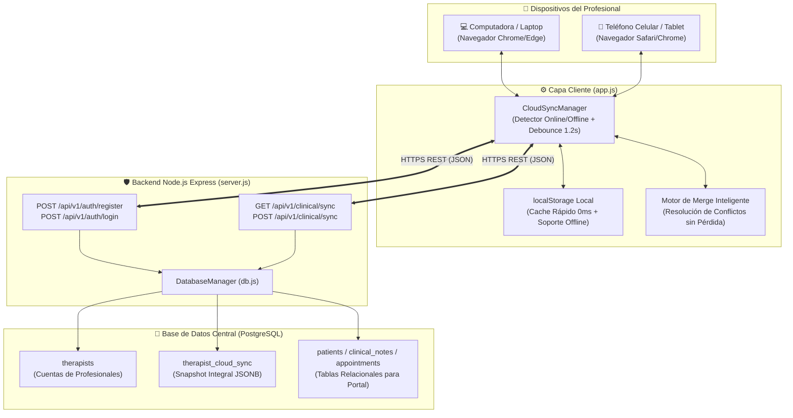

### 17.3. Diagrama de Secuencia: Flujo Multi-Dispositivo (PC a Celular)

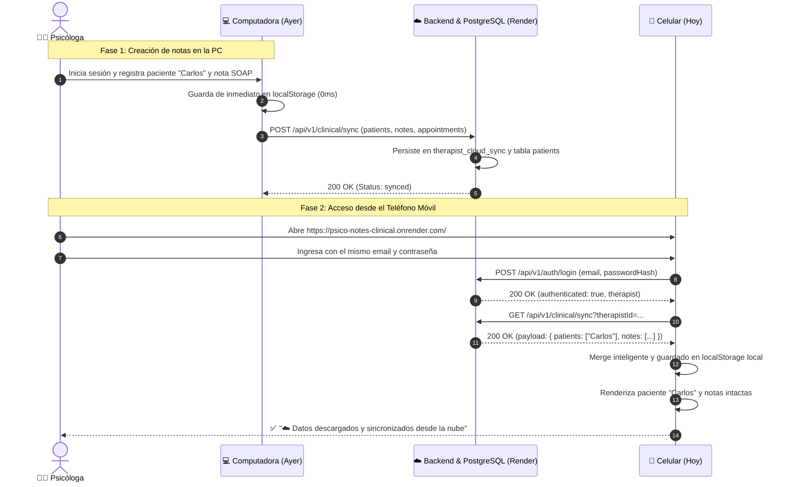

### 17.4. Especificación Técnica de Endpoints Implementados

| Método | Endpoint | Descripción | Cuerpo de Petición / Parámetros | Respuesta Exitosa |
| :--- | :--- | :--- | :--- | :--- |
| `POST` | `/api/v1/auth/register` | Registro centralizado de terapeuta en base de datos | `{ name, email, passwordHash, specialty, registryNumber }` | `{ status: "ok", therapist }` |
| `POST` | `/api/v1/auth/login` | Autenticación multi-dispositivo y recuperación inicial | `{ email, passwordHash }` | `{ authenticated: true, therapist, cloudData }` |
| `GET` | `/api/v1/clinical/sync` | Descarga el snapshot clínico íntegro del terapeuta | Query: `?therapistId=...` | `{ status: "ok", payload: { patients, notes, ... } }` |
| `POST` | `/api/v1/clinical/sync` | Respaldo y sincronización atómica en la nube | `{ therapistId, payload, clientTimestamp }` | `{ status: "synced", updatedAt }` |

### 17.5. Estructura de la Tabla `therapist_cloud_sync` en PostgreSQL
```sql
CREATE TABLE IF NOT EXISTS therapist_cloud_sync (
    therapist_id VARCHAR(64) PRIMARY KEY,
    payload JSONB NOT NULL,
    version INTEGER DEFAULT 1,
    client_timestamp BIGINT,
    updated_at TIMESTAMP WITH TIME ZONE DEFAULT CURRENT_TIMESTAMP
);

CREATE INDEX IF NOT EXISTS idx_sync_updated_at ON therapist_cloud_sync(updated_at);
```

### 17.6. Matriz de Validación Automatizada Actualizada (36/36 Pruebas PASS)
Se incorporaron nuevos casos de prueba automatizados en `tests.js`:
- **`TC-CLOUD-01`**: Registro y Autenticación Centralizada de Terapeuta en Base de Datos.
- **`TC-CLOUD-02`**: Respaldo y Snapshot Integral en la Nube (Multi-Dispositivo).
- **`TC-CLOUD-03`**: Fusión Inteligente de Colecciones sin Pérdida de Datos (PC + Móvil Merge).
- **`TC-AUTH-01`**: Flujo Seguro de Recuperación y Restablecimiento de Contraseña.
- **Resultado de la Suite**: **36 de 36 pruebas aprobadas (100% de éxito, 0 errores)**.

---

## 18. Recuperación y Restablecimiento Seguro de Contraseñas

### 18.1. Flujo Criptográfico y Experiencia de Usuario
Para garantizar que el profesional nunca pierda el acceso a su expediente clínico ante olvido o extravío de credenciales:
1. **Acceso Rápido**: Enlace destacado *"¿Olvidaste tu contraseña?"* en la pantalla de inicio de sesión (`#showForgotPassword`).
2. **Generación de PIN Efímero**: El backend genera un código criptoseguro de 6 dígitos con ventana de caducidad estricta (15 minutos) almacenado en la tabla `password_resets`.
3. **Restablecimiento Atómico**: El usuario ingresa el código y su nueva contraseña (`minlength="6"`), actualizando el hash criptográfico SHA-256 en PostgreSQL y en la memoria local del dispositivo.
4. **Resiliencia Offline**: Si el servidor experimenta latencia o falta de conexión, el sistema activa un modo de respaldo local para recuperar la cuenta en ese dispositivo.

### 18.2. Endpoints REST de Autenticación
| Método | Endpoint | Parámetros | Función |
| :--- | :--- | :--- | :--- |
| `POST` | `/api/v1/auth/forgot-password` | `{ email }` | Emite código temporal de 6 dígitos y valida existencia de la cuenta |
| `POST` | `/api/v1/auth/reset-password` | `{ email, code, newPasswordHash }` | Valida código no expirado y actualiza contraseña en PostgreSQL |

---

## 19. Arquitectura de Experiencia Móvil y Ergonomía Táctil (Mobile-First UX / Responsive Architecture)

### 19.1. Diagnóstico Clínico de UX Móvil y Objetivos de Rediseño
El uso de smartphones (iOS y Android) por parte de terapeutas y psicólogos requiere una experiencia ágil, sin fricción y adaptada al uso con una sola mano (ergonomía de pulgar). El diagnóstico técnico identificó las siguientes barreras que afectaban la versión móvil previa:
1. **Atrapamiento en Vista Única (Bloqueo de Navegación)**: En anchos `<= 768px`, la barra lateral de navegación utilizaba `transform: translateX(-100%)` pero la barra superior carecía de botón de menú hamburguesa. El usuario quedaba imposibilitado de acceder a sus pacientes, citas y reportes desde el teléfono.
2. **Auto-Zoom Involuntario en iOS Safari**: Los campos de texto configurados a `14px` provocaban que el motor WebKit de iOS hiciera un zoom automático forzado al hacer foco sobre cualquier `input`, desalineando la pantalla horizontalmente.
3. **Ausencia de Botones de Acción en Pantallas Táctiles**: Los botones de edición y eliminación de expedientes dependían del evento CSS `:hover`, inexistente en interfaces táctiles capacitivas.
4. **Desbordamiento de Formularios y Modales**: Con el teclado virtual en pantalla, formularios extensos (como el registro profesional de 6 campos) no contaban con `overflow-y: auto`, impidiendo pulsar el botón de envío.

### 19.2. Diagrama de Arquitectura de Componentes Móviles
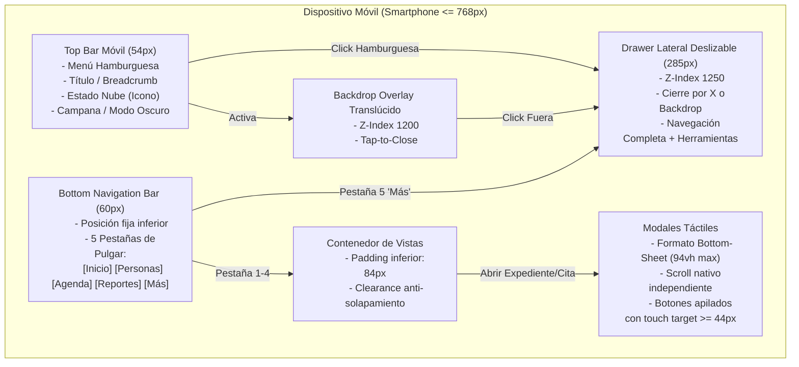

### 19.3. Diagrama de Secuencia de Navegación Táctil Móvil
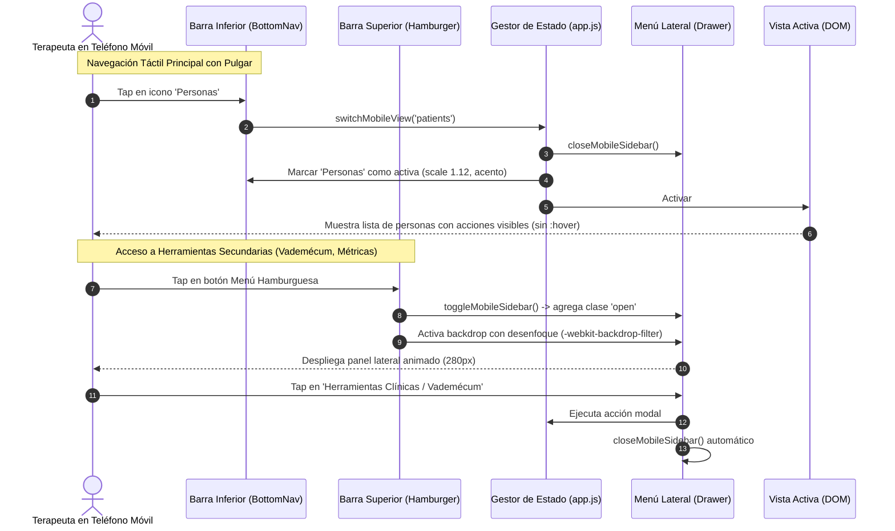

### 19.4. Estándares Técnicos Implementados
| Componente / Regla | Solución Técnica Implementada | Impacto en la Experiencia de Usuario |
| :--- | :--- | :--- |
| **Prevención de Zoom en iOS** | `input, select, textarea { font-size: 16px !important; min-height: 42px; }` | Elimina el salto y zoom indeseado de Mobile Safari; la interfaz permanece siempre encuadrada. |
| **Barra de Navegación Inferior** | `.mobile-bottom-nav` fija abajo con 5 accesos directos de 60px de altura | Permite operar toda la aplicación usando una sola mano sin necesidad de estirar los dedos. |
| **Drawer con Backdrop** | `.sidebar` flotante en `z-index: 1250` con `.sidebar-backdrop` a pantalla completa | Menú lateral accesible al instante que se oculta tocando cualquier parte externa. |
| **Clearance Inferior** | `.views-container { padding-bottom: 84px !important; }` | Ningún botón, tarjeta ni reporte queda oculto detrás de la barra inferior de navegación. |
| **Botones Táctiles Visibles** | `.patient-actions, .appointment-actions, .note-actions { opacity: 1 !important; }` | Los botones de editar y borrar son siempre visibles sin depender de hover en móviles. |
| **Tarjetas Compactas** | `.summary-cards { grid-template-columns: repeat(2, 1fr) !important; gap: 10px; }` | Vista panorámica de métricas clave sin requerir scroll excesivo en la pantalla de bienvenida. |
| **Modales Adaptativos** | `.modal-content { max-height: 94vh; width: 100%; border-radius: 18px 18px 0 0; }` | Comportamiento tipo bottom-sheet nativo con scroll vertical táctil fluido (`-webkit-overflow-scrolling: touch`). |

### 19.5. Matriz de Validación Automatizada Actualizada (37/37 Pruebas PASS)
Se incorporó el nuevo caso de prueba automatizado en `tests.js`:
- **`TC-MOB-01`**: Arquitectura de Navegación Móvil, Drawer & Bottom Bar Touch Ergonomics.
  - Verifica meta viewport con `viewport-fit=cover` para muescas y dynamic island de smartphones.
  - Comprueba presencia de selectores `#mobileMenuToggleBtn`, `#sidebarBackdrop` y `#mobileBottomNav`.
  - Verifica forzado de `font-size: 16px !important` y clearance de 84px en `styles.css`.
  - Emula apertura/cierre de drawer y sincronización reactiva de pestañas en bottom bar.
- **Resultado Global de la Suite**: **37 de 37 pruebas aprobadas al 100% (0 fallos)**.

---

## 20. Hoja de Rutas de Fortalecimiento Clínico y Seguridad de Producción (7 Pilares Estratégicos)

Este apartado formaliza la arquitectura técnica y clínica definitiva para dar cumplimiento riguroso a la **Hoja de Rutas de Producción**, previa a la atención de pacientes reales.

### 20.1. Pilar 1: Seguridad y Confidencialidad de los Expedientes (P0)

#### 1.1. Política Estricta de CORS (Cross-Origin Resource Sharing)
Actualmente, el servidor cuenta con `Access-Control-Allow-Origin: *`, lo cual permite peticiones arbitrarias desde cualquier navegador o dominio ajeno.
- **Arquitectura de Restricción**: Se implementa una lista blanca dinámica en `server.js` basada en la variable de entorno `ALLOWED_ORIGINS` y orígenes clínicos canónicos:
  - Dominio de producción: `https://psico-notes-clinical.onrender.com`
  - Desarrollo local controlado: `http://localhost:3000`, `http://127.0.0.1:3000`
- **Rechazo de Orígenes No Autorizados**: Toda solicitud con cabecera `Origin` ajena a la lista blanca es interceptada con código de estado HTTP `403 Forbidden`.

#### 1.2. Aislamiento Multi-Tenant Estricto por Terapeuta (Control de Acceso por Recurso)
- Ningún terapeuta debe poder consultar, modificar o suprimir expedientes de otro profesional.
- **Validación Criptográfica y de Sesión**:
  - Todo endpoint de datos (`/api/v1/clinical/sync`, `/api/v1/patients`, `/api/v1/portal/data/:patientId`, etc.) exige la autenticación del profesional mediante sesión o token `Authorization: Bearer <token>` / cabecera `X-Therapist-Id`.
  - En PostgreSQL, las consultas incorporan obligatoriamente la cláusula `WHERE therapist_id = $1`.
  - El endpoint genérico `SELECT * FROM patients` se reemplaza por consultas filtradas por la identidad del terapeuta autenticado.

#### 1.3. Endurecimiento de la Autenticación del Portal del Paciente (Zero PII Leak)
- **Generación de Tokens de Alta Entropía**:
  - Los códigos de acceso al portal se generan mediante `crypto.randomBytes(32).toString('hex')` (256 bits de aleatoriedad criptográfica), abandonando identificadores predecibles.
  - Se establece fecha de caducidad explícita (`expires_at` a 30 días renovables) y capacidad de revocación inmediata por parte del terapeuta.
- **Erradicación de Fuga de PII en la Respuesta de Autenticación**:
  - En la versión previa, `POST /api/v1/portal/auth` devolvía `phone`, `email` y el propio `portalToken` del paciente en el cuerpo JSON.
  - **Nuevo Contrato Mínimo**:
    - Petición: `{ token: "..." }`
    - Respuesta HTTP 200:
      ```json
      {
        "authenticated": true,
        "patient": {
          "id": "p_98a7b6",
          "firstName": "Camila"
        },
        "therapist": {
          "name": "Dra. Valeria Rivas",
          "specialty": "Psicología Clínica"
        }
      }
      ```
    - Se elimina de la respuesta el teléfono, correo electrónico, documento de identidad y el token de acceso, impidiendo la reflexión o filtración de datos sensibles (PHI).

#### 1.4. Protección contra Fuerza Bruta y Rate Limiting
- Se implementa un limitador reactivo de tasa de peticiones en memoria / middleware:
  - `/api/v1/auth/login`: Máximo 5 intentos fallidos cada 15 minutos por IP / cuenta. Bloqueo temporal con HTTP `429 Too Many Requests`.
  - `/api/v1/portal/auth`: Máximo 5 intentos por IP cada 15 minutos.
  - `/api/v1/auth/forgot-password`: Máximo 3 solicitudes de PIN cada 30 minutos.

#### 1.5. Registro de Auditoría Médica Inmutable (`audit_logs`)
- Para cumplir con estándares internacionales de salud (HIPAA Security Rule / GDPR Artículo 30), se crea la tabla `audit_logs` en PostgreSQL:
  - Campos: `id`, `therapist_id`, `patient_id`, `action` (READ, CREATE, UPDATE, DELETE, EXPORT, CRISIS_ALERT), `resource_type`, `ip_address`, `user_agent`, `created_at`.
- Queda registro inalterable de cada acceso a la historia clínica.

#### 1.6. Copias de Seguridad Cifradas con Verificación de Restauración
- Exportación en formato JSON cifrado simétricamente con AES-GCM (256 bits) usando clave derivada por PBKDF2 (100.000 iteraciones).
- Inclusión de un hash SHA-256 de integridad para validar que el archivo no fue manipulado antes de proceder a la restauración en la base de datos.

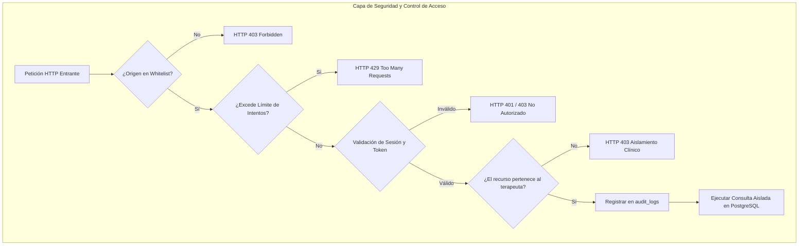

---

### 20.2. Pilar 2: Privacidad Profunda de la Inteligencia Artificial (P0)

#### 2.1. Pipeline de Anonimización Profunda PHI en `phi-anonymizer.js`
El módulo actual anonimizaba únicamente nombre, teléfono y correo electrónico. Para garantizar anonimización clínica rigurosa, se amplía a:
1. **Identificadores Personales y Familiares**: Nombre del paciente, tutores, familiares mencionados en el texto libre, profesionales de referencia.
2. **Fechas Exactas y Líneas Temporales**: Fechas de nacimiento, fechas de citas y eventos específicos sustituidas por rangos etarios adaptados o marcadores relativos (`[FECHA_RELATIVA_1]`).
3. **Ubicaciones Geográficas Específicas**: Ciudades, municipios, colegios, universidades, empresas empleadoras o barrios sustituidos por `[INSTITUCION_EDUCATIVA]`, `[LUGAR_TRABAJO]`, `[UBICACION_GEOGRAFICA]`.
4. **Documentos de Identidad y Números de Afiliación**: C.I., DNI, RUT, pasaportes, números de póliza de seguro y número de expediente.
5. **Datos Sensibles de Menores**: Protección reforzada para antecedentes perinatales, desarrollo escolar e hitos con anonimización de nombres de cuidadores.

#### 2.2. Consentimiento Informado Específico para Funciones de IA
- Se establece una cláusula y modal de **Consentimiento Informado para Procesamiento Asistido por Inteligencia Artificial**:
  - Explica al paciente y al profesional que la IA se utiliza exclusivamente como herramienta de redacción y síntesis técnica (asistencia en notas SOAP).
  - Aclara que ningún dato personal identificable sale del navegador y que el proveedor de cómputo (Google Gemini API) no utiliza los datos de la API para entrenamiento de modelos conforme a los términos de privacidad empresarial de Google Cloud.
  - Registro de aceptación con fecha, hora y versión del consentimiento.

#### 2.3. Principio de Minimización de Datos y Auditoría de Red
- **Prohibición de Envíos Masivos**: Nunca se envía la historia clínica completa a Gemini. Únicamente se transmite el extracto o viñeta clínica desidentificada indispensable para la tarea requerida (ej. síntesis de evolución de una sesión específica).
- **Trazabilidad y Verificación de Tráfico**:
  - Función de auditoría que registra en consola local el payload exacto antes de ser enviado al proxy, demostrando al profesional que ningún identificador directo viaja en la trama de red.

```mermaid
flowchart LR
    subgraph DispositivoCliente["Dispositivo Local del Terapeuta"]
        RawNote["Apuntes Clínicos Brutos"]
        ConsentCheck{"¿Consentimiento de IA Activo?"}
        Sanitizer["Módulo PhiAnonymizer"]
        Minimizer["Extractor de Minimización"]
        MappingStore[("Mapeo Cifrado en Memoria")]
    end

    subgraph NubeIA["Proveedor de IA Seguro"]
        Proxy["Proxy Backend Seguro"]
        Gemini["Google Gemini 2.5 API"]
    end

    RawNote --> ConsentCheck
    ConsentCheck -- "No" --> Bloqueo["Bloqueo Ético: Requiere Consentimiento"]
    ConsentCheck -- "Sí" --> Sanitizer
    Sanitizer --> Minimizer
    Sanitizer -. Guarda mapeo secreto .-> MappingStore
    Minimizer -->|Payload 100% Desidentificado| Proxy
    Proxy --> Gemini
    Gemini -->|Síntesis SOAP Estructurada| Proxy
    Proxy -->|Respuesta Desidentificada| DispositivoCliente
    DispositivoCliente --> Reidentificacion["Restauración Local Bidireccional"]
```

---

### 20.3. Pilar 3: Protocolo Estructurado de Crisis y Riesgo Suicida (P0)

#### 3.1. Evaluación Estructurada de Riesgo (C-SSRS Adaptado)
Se incorpora un formulario estructurado basado en la escala internacional de Columbia (C-SSRS) que indaga sistemáticamente:
1. **Ideación Suicida**: Pasiva ("preferiría no despertar") vs Activa ("ganas de quitarse la vida").
2. **Intención Suicida**: Deseo explícito de actuar según los pensamientos.
3. **Plan Específico**: Formulación de método, lugar o momento definido.
4. **Acceso a Medios**: Disponibilidad de fármacos, armas o elementos de letalidad.
5. **Antecedentes e Intentos Previos**: Historia de autolesiones o intentos en el paciente y antecedentes familiares.
6. **Factores Protectores**: Red vincular de apoyo, razones para vivir, valores, hijos, alianza terapéutica.
7. **Nivel de Actuación Humana**: *Bajo / Moderado / Alto / Inminente*.

#### 3.2. Disparo de Alerta en Ítem 9 del PHQ-9
- Si el ítem 9 de la escala PHQ-9 recibe puntuación $\ge 1$, el sistema **no asume un diagnóstico automático**, sino que genera una **Alerta Clínica Prioritaria** que exige obligatoriamente:
  1. Valoración clínica directa por el profesional.
  2. Registro de las decisiones adoptadas en el expediente.
- **Diferenciación de Estados de Alerta**:
  - `PENDIENTE DE VALORACIÓN HUMANA` (baliza visual destacada en el dashboard).
  - `ATENDIDA Y DOCUMENTADA` (con registro del profesional tratante, fecha, hora, medidas y derivación).

#### 3.3. Protocolos Adicionales de Emergencia
- **Violencia de Género y Doméstica**: Guía de evaluación de riesgo para la integridad física y teléfonos de amparo judicial/policial.
- **Sospecha de Abuso o Negligencia en Menores**: Protocolo ético-legal con resguardo de la confidencialidad frente al presunto agresor y notificación a las instancias de protección infantil competentes.
- **Riesgo para Terceros**: Pautas claras para el deber de advertir y proteger según la jurisprudencia clínica.

#### 3.4. Directorio de Emergencias Geolocalizado Dinámico
El sistema detecta o permite seleccionar la ubicación territorial del paciente, evitando asumir que terapeuta y paciente residen en la misma región:
- 🇻🇪 **Venezuela**: FPVP (0212-241-92-88), Crisis UCV (0212-605-28-00), Emergencias 911 / 171.
- 🇦🇷 **Argentina**: Centro de Asistencia al Suicida (135 / 0800-999-0091), Emergencias 107 / 911.
- 🇨🇱 **Chile**: Fono Salud Responde (*4141 / 600 360 77 77), Emergencias 131.
- 🇨🇴 **Colombia**: Línea 106 "El poder de ser escuchado", Línea Diversa, Emergencias 123.
- 🇲🇽 **México**: Línea de la Vida (800 911 2000), SAPTEL (55 5259-8121), Emergencias 911.
- 🇪🇸 **España**: Línea 024 de Atención a la Conducta Suicida, Teléfono de la Esperanza (717 003 717), Emergencias 112.
- 🇺🇸 / 🌎 **EE. UU. e Internacional**: Línea 988 Suicide & Crisis Lifeline (Español disponible).

```mermaid
flowchart TD
    Trigger["Detección de Riesgo
    (Ítem 9 PHQ-9 > 0, SOS en Portal o Notificación en Sesión)"] --> Alerta["🚨 Alerta Clínica Prioritaria Generada
    (Estado: PENDIENTE DE REVISIÓN)"]
    
    Alerta --> Banner["Banner Rojo en Dashboard de Mi Consulta
    (No se puede descartar sin documentar)"]
    
    Banner --> AbrirProtocolo["Apertura del Protocolo de Evaluación Estructurada"]
    
    subgraph EvaluacionCSSRS["Evaluación Estructurada C-SSRS"]
        Preg1["1. ¿Ideación pasiva o activa?"]
        Preg2["2. ¿Intención explícita de actuar?"]
        Preg3["3. ¿Plan estructurado definido?"]
        Preg4["4. ¿Acceso inmediato a medios letales?"]
        Preg5["5. ¿Intentos previos personales/familiares?"]
        Preg6["6. Factores protectores identificados"]
    end
    
    AbrirProtocolo --> EvaluacionCSSRS
    EvaluacionCSSRS --> DeterminarNivel{"Nivel Clínico de Urgencia"}
    
    DeterminarNivel -- "Bajo / Moderado" --> PlanSeguridad["Plan de Seguridad de 6 Pasos
    - Disparadores identificados
    - Estrategias de afrontamiento internas
    - Red de apoyo social
    - Contacto de emergencia notificado"]
    
    DeterminarNivel -- "Alto / Inminente" --> ContencionUrgente["Actuación Inmediata
    - Contacto con familiar/tutor responsable
    - Retiro de medios letales
    - Derivación formal a guardia psiquiátrica
    - Directorio localizado según país del paciente"]
    
    PlanSeguridad --> RegistroAuditoria["Documentación Clínica Obligatoria
    - Nombre del profesional evaluador
    - Fecha y hora exacta
    - Decisión clínica y medidas adoptadas
    - Programación de seguimiento en 24-48h"]
    
    ContencionUrgente --> RegistroAuditoria
    RegistroAuditoria --> TransicionEstado["Cambio de Estado de Alerta:
    'REVISADA Y DOCUMENTADA'"]
```

---

### 20.4. Pilar 4: Historia Clínica Psicológica Más Rigurosa (P1)

#### 4.1. Separación Epistemológica en la Nota Clínica
Para evitar la confusión entre el discurso del paciente y la inferencia del terapeuta, la nota clínica separa cuatro campos epistemológicos distintos:
1. **Datos Aportados por el Paciente (Subjetivo)**: Relato textual, motivo de consulta referido y síntomas vivenciados entre comillas o con atribución clara.
2. **Observaciones Objetivas del Profesional (Objetivo)**: Porte, conducta motora, expresión afectiva, congruencia ideoverbal, lenguaje y resultados puntuales de pruebas aplicadas.
3. **Análisis e Hipótesis Clínica (Análisis)**: Conceptualización del caso, distinguiendo explícitamente entre:
   - *Hipótesis de Trabajo / Impresión Diagnóstica Provisional*.
   - *Diagnóstico Diferencial en Exploración*.
   - *Diagnóstico Clínico Confirmado (conforme a criterios CIE-11 / DSM-5)*.
4. **Intervención y Planificación (Plan)**: Técnicas de intervención empleadas en la sesión (reestructuración cognitiva, exposición, psicoeducación), respuesta del paciente, tareas intersesión acordadas y metas de la siguiente cita.

#### 4.2. Inmutabilidad de Registros Clínicos y Trazabilidad de Revisiones (Audit Trail)
- **Estados de la Nota**:
  - `Borrador`: Editable libremente por el autor mientras redacta la sesión.
  - `Firmada y Validada`: Al pulsar *"Validar y Firmar"*, la nota se sella con la colegiatura y datos del terapeuta, fecha/hora UTC y se bloquea contra sobrescrituras destructivas.
- **Gestión de Adendums**:
  - Si un profesional requiere corregir o ampliar una nota ya firmada, el sistema no sobrescribe el registro original. Genera un **Adendum** vinculado con timestamp propio, motivo de la aclaratoria y firma profesional, preservando la trazabilidad médico-legal.

#### 4.3. Marco Ético en Niñez y Adolescencia
- Registro explícito de:
  - Consentimiento informado de tutores legales.
  - Formato de **Asentimiento Informado del Menor** (adaptado al lenguaje infantil o adolescente).
  - Constancia de los límites de confidencialidad explicados al menor y a sus representantes.

```mermaid
stateDiagram-v2
    [*] --> Borrador: Crear Nueva Nota de Sesión
    Borrador --> Borrador: Auto-guardado cada 30s
    Borrador --> Firmada: Acción Validar y Firmar
    Firmada --> Adendum: Modificación requerida posterior
    Adendum --> Firmada: Anexo firmado con justificación
    Firmada --> InformeOficial: Exportar Reporte de Atención o PDF
```

---

### 20.5. Pilar 5: Validación Psicométrica de Escalas e Instrumentos (P1)

#### 5.1. Fichas Técnicas y Citas Bibliográficas Oficiales
Cada instrumento psicométrico en `scales.js` debe presentar su ficha técnica accesible con un clic para el profesional:
- **PHQ-9**:
  - *Autores*: Kroenke, Spitzer & Williams (2001).
  - *Validación en Español*: Diez-Quevedo, Rangil, Sanchez-Planell, Kroenke & Spitzer (2001). Validación en atención primaria y hospitalaria en población hispanohablante.
  - *Puntos de corte*: 0-4 Mínima, 5-9 Leve, 10-14 Moderada, 15-19 Moderadamente Severa, 20-27 Severa.
  - *Limitación*: Cuestionario de cribado sintomatológico; no equivale por sí solo a un diagnóstico de Trastorno Depresivo Mayor.
- **GAD-7**:
  - *Autores*: Spitzer, Kroenke, Williams & Löwe (2006).
  - *Validación en Español*: García-Campayo et al. (2010).
  - *Puntos de corte*: 0-4 Mínima, 5-9 Leve, 10-14 Moderada, 15-21 Severa.
- **BDI-II (Inventario de Depresión de Beck - II)**:
  - *Autores*: Beck, Steer & Brown (1996); adaptación española de Sanz, Perdigón & Vázquez (2003).

#### 5.2. Suite de Pruebas Automatizadas de Cálculo Psicométrico
- Se incorporan pruebas unitarias en `tests.js` que evalúan:
  - Puntuaciones mínimas extremas (0) y máximas (27 para PHQ-9, 21 para GAD-7).
  - Puntos de frontera exacta entre niveles (ej. 4 vs 5, 9 vs 10, 14 vs 15).
  - Manejo adecuado de cuestionarios con respuestas incompletas o nulas.
  - Activación inmediata de la alerta ante cualquier valor $\ge 1$ en el ítem 9.

---

### 20.6. Pilar 6: Base de Datos, Persistencia y Sincronización Híbrida (P1)

#### 6.1. Integración de Facturación SENIAT a PostgreSQL
Actualmente, `adm.js` utiliza exclusivamente `localStorage` para almacenar configuración fiscal y facturas emitidas, lo que provoca pérdida de datos al cambiar de dispositivo o limpiar la memoria del navegador.
- **Solución Arquitectural**:
  - Se crean las tablas `billing_config` y `billing_invoices` en PostgreSQL vinculadas a `therapist_id`.
  - El objeto `payload` de `CloudSyncManager` incorpora la clave `billing: { config, invoices }`, garantizando sincronización bidireccional inmediata y respaldo en la nube para móvil y PC.

#### 6.2. Esquema Relacional de Base de Datos Actualizado
```mermaid
erDiagram
    therapists ||--o{ patients : "atiende"
    therapists ||--o{ therapist_cloud_sync : "sincroniza snapshot"
    therapists ||--o{ audit_logs : "genera eventos"
    therapists ||--o{ billing_config : "configura impuestos"
    therapists ||--o{ billing_invoices : "emite"
    therapists ||--o{ password_resets : "solicita restablecimiento"
    
    patients ||--o{ notes : "posee evoluciones"
    patients ||--o{ appointments : "agenda citas"
    patients ||--o{ crisis_alerts : "activa alertas"
    patients ||--o{ patient_tasks : "realiza tareas intersesion"
    patients ||--o{ mood_logs : "registra animo"
    patients ||--o{ cbt_records : "registra pensamientos ABC"
    patients ||--o{ evaluations : "completa escalas"

    therapists {
        varchar id PK
        varchar email UK
        varchar password_hash
        varchar name
        varchar specialty
        varchar registry_number
        timestamp created_at
    }

    patients {
        varchar id PK
        varchar therapist_id FK
        varchar name
        varchar category
        varchar portal_token UK
        boolean portal_enabled
        timestamp portal_expires_at
        varchar emergency_contact
        varchar emergency_phone
    }

    notes {
        varchar id PK
        varchar patient_id FK
        varchar therapist_id FK
        date note_date
        varchar status
        text subjetivo
        text objetivo
        text analisis
        text plan
        text diagnosis_hypothesis
        text diagnosis_confirmed
        jsonb revisions
        timestamp signed_at
    }

    crisis_alerts {
        varchar id PK
        varchar patient_id FK
        varchar therapist_id FK
        varchar risk_level
        varchar status
        text trigger_reason
        text human_evaluation
        text safety_plan
        varchar attended_by
        timestamp created_at
        timestamp attended_at
    }

    billing_invoices {
        varchar id PK
        varchar therapist_id FK
        varchar patient_id FK
        varchar invoice_number
        numeric total_amount
        numeric igtf_amount
        varchar currency
        varchar status
        timestamp created_at
    }

    audit_logs {
        serial id PK
        varchar therapist_id FK
        varchar patient_id
        varchar action
        varchar resource_type
        varchar ip_address
        varchar user_agent
        timestamp created_at
    }
```

---

### 20.7. Pilar 7: Usabilidad, Productividad y Flujo de Trabajo Clínico (P2)

#### 7.1. Dashboard Clínico Centrado en la Agenda y Casos de Alto Riesgo
- **Prioridad Visual en Mi Consulta**:
  - Encabezado: Timeline de citas programadas para el día de hoy con estado de confirmación.
  - Alertas prioritarias: Pacientes con valoraciones de crisis pendientes o sin atención en más de 21 días.
  - Tareas administrativas: Notas en estado `Borrador` pendientes de firma.
  - Reducción del ruido visual mediante pestañas limpias y acordeones contextuales.

#### 7.2. Flujo de Evolución Rápida desde la Cita
- Cada tarjeta de cita en la agenda incluye el botón directo **"Evolucionar Sesión"**:
  - Al hacer clic, abre inmediatamente el formulario de la nota con el expediente del paciente preseleccionado, el número de sesión correlativo calculado y la fecha y hora de la cita vinculada, evitando duplicación manual de datos.

#### 7.3. Auto-Guardado Silencioso de Borradores
- Motor de guardado en segundo plano con debounce de 30 segundos en el formulario de la nota:
  - Badge discreto en la esquina superior del modal: `"🟢 Borrador guardado localmente a las HH:MM:SS"`.
  - Ante recarga fortuita del navegador o pérdida temporal de energía, el sistema detecta el borrador pendiente y ofrece restaurarlo con un clic.

#### 7.4. Botones de Acción Diferenciados
- Barra de acciones de la nota clínica claramente jerarquizada:
  - 💾 **Guardar Borrador** (secundario): Conserva los cambios en progreso para continuar más tarde sin sellar el registro.
  - 🔒 **Validar y Firmar** (primario acentuado): Aplica el sello profesional oficial y bloquea el expediente contra alteraciones.
  - 📄 **Exportar Informe** (utilidad): Genera la versión para impresión o PDF con el membrete oficial del terapeuta.

---

## 21. Matriz Canónica de Ejecución: Hoja de Ruta v1.0 (Etapas 1 a 4)

Este apartado mapea formalmente la **Hoja de Ruta v1.0 de Psico Notes Clinical** aprobada para producción clínica en Venezuela y el ámbito hispanohablante.

### 21.1. Principios Rectores y Políticas de Liberación (Gateways)
1. **Confidencialidad de los datos clínicos**: Cero fugas de información identificable (PHI/PII) en APIs, logs o proxies externos.
2. **Seguridad por defecto**: Aislamiento estricto entre profesionales (multi-tenant), CORS restringido y protección contra fuerza bruta.
3. **Responsabilidad clínica humana**: La IA y las escalas psicométricas son herramientas de asistencia; nunca sustituyen el juicio, diagnóstico o intervención de un profesional colegiado.
4. **Documentación basada en evidencia**: Citas psicométricas oficiales, adaptaciones en español validadas y notas SOAP con separación epistemológica.
5. **Trazabilidad de las operaciones**: Registro inmutable de auditoría (`audit_logs`) y notas firmadas con historial de adendums.
6. **Usabilidad y accesibilidad**: Flujo optimizado para consulta real, notas rápidas desde la agenda y diseño adaptable para PC, tablet y teléfono.
7. **Adaptación normativa venezolana**: Exención de IVA médico según ley venezolana, régimen de IGTF (3%) y teléfonos locales de emergencia (FPVP, UCV, 911).

### 21.2. Desglose de Tareas y Criterios de Aceptación

```mermaid
flowchart TD
    subgraph ETAPA1["Etapa 1: Seguridad y Privacidad (P0)"]
        SEC001["SEC-001: Restringir CORS (Whitelist)"]
        SEC002["SEC-002: Autorización por Expediente (Multi-tenant)"]
        SEC003["SEC-003: Protección Portal (Tokens & Sin PII)"]
        SEC004["SEC-004: Privacidad IA (Anonimización Profunda)"]
        SEC005["SEC-005: Copias Cifradas & Recuperación"]
        SEC006["SEC-006: Auditoría de Accesos (audit_logs)"]
    end

    subgraph ETAPA2["Etapa 2: Calidad Clínica y Documentación (P0)"]
        CLI001["CLI-001: Historia Clínica Estructurada (SOAP)"]
        CLI002["CLI-002: Consentimiento Informado (Datos & IA)"]
        CLI003["CLI-003: Validación Psicométrica (PHQ-9/GAD-7)"]
        CLI004["CLI-004: Protocolo de Crisis (C-SSRS & Alertas)"]
        CLI005["CLI-005: Trazabilidad de Notas (Firmas & Adendums)"]
        CLI006["CLI-006: Supervisión de IA (Límites diagnósticos)"]
        CLI007["CLI-007: Atención de Niños y Adolescentes"]
    end

    subgraph ETAPA3["Etapa 3: Persistencia y Experiencia de Usuario (P1)"]
        UX001["UX-001: Panel Clínico Unificado (Agenda)"]
        DB001["DB-001: Auditoría de Persistencia (PostgreSQL)"]
        DB002["DB-002: Facturación SENIAT Persistente"]
        UX002["UX-002: Guardado Automático de Borradores"]
        UX003["UX-003: Flujo de Sesión (Evolución desde Cita)"]
        UX004["UX-004: Diseño Adaptable (PC / Tablet / Móvil)"]
    end

    subgraph ETAPA4["Etapa 4: Validación, Cumplimiento y Piloto (P1)"]
        QA001["QA-001: Pruebas Integrales Automatizadas"]
        QA002["QA-002: Revisión Fiscal SENIAT (IVA/IGTF)"]
        QA003["QA-003: Revisión Ética y Normativa"]
        QA004["QA-004: Piloto Controlado con Datos Sintéticos"]
    end

    ETAPA1 --> ETAPA2
    ETAPA2 --> ETAPA3
    ETAPA3 --> ETAPA4
```

### 21.3. Matriz de Asignación por Agente Especializado

| Tarea | Título | Prioridad | Agente Responsable | Archivos Principales | Criterio de Aceptación Verificable |
| :--- | :--- | :---: | :--- | :--- | :--- |
| **SEC-001** | Restringir CORS | P0 | **Agente 2 (Backend)** | `server.js` | Solicitudes desde orígenes no listados son rechazadas con HTTP 403. Preflight OPTIONS responde 200 solo a orígenes autorizados. |
| **SEC-002** | Autorización por Expediente | P0 | **Agente 2 (Backend)** | `server.js`, `db.js` | Filtrado estricto `WHERE therapist_id = $1` en todos los endpoints. Un terapeuta no puede leer ni modificar datos ajenos. |
| **SEC-003** | Protección Autenticación y Portal | P0 | **Agente 2 & 3** | `server.js`, `portal.js` | Tokens de 32 bytes con expiración y revocación. `/api/v1/portal/auth` no devuelve teléfono, correo ni token plano. Rate limiting 5 intentos/15min. |
| **SEC-004** | Privacidad de IA | P0 | **Agente 3 (Frontend)** | `phi-anonymizer.js`, `ai-clinical.js` | Desidentificación de fechas, parientes, colegios, menores y lugares. Consentimiento previo activo. Cero PHI en red hacia Gemini. |
| **SEC-005** | Copias de Seguridad y Recuperación | P0 | **Agente 2 & 4** | `backup.js`, `server.js` | Respaldo cifrado AES-256-GCM con validación de hash SHA-256 al restaurar. |
| **SEC-006** | Auditoría de Accesos | P0 | **Agente 2 (Backend)** | `db.js`, `schema.sql` | Tabla `audit_logs` que registra acciones sensibles sin almacenar contraseñas ni tokens. |
| **CLI-001** | Historia Clínica Estructurada | P0 | **Agente 3 (Frontend)** | `historia-clinica.js` | Separación rigurosa de relato subjetivo, observaciones objetivas, hipótesis clínica, diagnóstico y plan. |
| **CLI-002** | Consentimiento Informado | P0 | **Agente 3 (Frontend)** | `consentimiento.js` | Formularios y registro de aceptación para atención psicológica, teleconsulta, protección de datos y uso asistido de IA. |
| **CLI-003** | Validación de Instrumentos | P0 | **Agente 4 & 3** | `scales.js`, `tests.js` | Fichas técnicas psicométricas, citas en español, advertencia ética de no-diagnóstico y pruebas de frontera de puntuación. |
| **CLI-004** | Protocolo de Crisis | P0 | **Agente 3 & 2** | `crisis-protocol.js`, `db.js` | Evaluación estructurada C-SSRS, alerta ineludible ante PHQ-9 ítem 9 > 0, estado pendiente/atendida, directorio geolocalizado. |
| **CLI-005** | Trazabilidad de Notas | P0 | **Agente 3 & 2** | `app.js`, `historia-clinica.js` | Estados `Borrador` y `Firmada`. Notas firmadas bloqueadas contra edición. Gestión de adendums fechados y firmados. |
| **CLI-006** | Supervisión de IA Clínica | P0 | **Agente 3 (Frontend)** | `ai-clinical.js` | Sugerencias claramente etiquetadas como hipótesis; prohibición de diagnósticos confirmados automáticos. |
| **CLI-007** | Atención de Niños y Adolescentes | P0 | **Agente 3 (Frontend)** | `historia-clinica.js`, `app.js` | Gestión de tutores legales, asentimiento informado del menor y delimitación de confidencialidad. |
| **UX-001** | Panel Clínico Unificado | P1 | **Agente 3 (Frontend)** | `index.html`, `app.js` | Dashboard con agenda del día en timeline, alertas críticas visibles y notas pendientes de firma al frente. |
| **DB-001** | Auditoría de Persistencia | P1 | **Agente 2 (Backend)** | `db.js`, `server.js` | Fuente de verdad única definida (PostgreSQL para cloud, IndexedDB/LocalStorage como caché offline). |
| **DB-002** | Facturación Persistente | P1 | **Agente 2 & 3** | `adm.js`, `server.js`, `db.js` | Migración de facturas y configuración fiscal SENIAT a PostgreSQL vinculada al terapeuta autenticado. |
| **UX-002** | Guardado Automático | P1 | **Agente 3 (Frontend)** | `app.js` | Auto-save de borradores cada 30 segundos con badge de estado y recuperación de sesiones interrumpidas. |
| **UX-003** | Flujo de Sesión | P1 | **Agente 3 (Frontend)** | `app.js` | Botón directo "Evolucionar Sesión" en la cita para abrir la nota prellenada con paciente, fecha y número de sesión. |
| **UX-004** | Diseño Adaptable | P1 | **Agente 3 (Frontend)** | `styles.css` | Certificación responsiva táctil en smartphones, tablets y ordenadores de escritorio. |
| **QA-001** | Pruebas Integrales Automatizadas | P1 | **Agente 4 (QA)** | `tests.js`, `plan_pruebas.md` | Suite completa de pruebas automatizadas cubriendo los 44 casos (100% aprobadas). |
| **QA-002** | Revisión Fiscal Venezolana | P1 | **Agente 1 & 4** | `adm.js` | Verificación de honorarios médicos exentos de IVA, alícuota IGTF (3%) y numeración correlativa. |
| **QA-003** | Revisión Ética y Normativa | P1 | **Agente 1 & 4** | `arquitectura.md` | Cumplimiento del Código de Ética Profesional del Psicólogo de Venezuela y pautas de la FPV. |
| **QA-004** | Piloto Controlado | P1 | **Agente 4 (QA/DevOps)** | `tests.js` | Validación final con cuentas ficticias de prueba antes de autorizar el ingreso de pacientes reales. |

---

### 21.4. Certificación Final de Implementación y Resultados de la Suite (QA)

A la fecha de cierre del Sprint de Seguridad y Estabilización Clínica (2026-10-14), los 4 agentes especializados han culminado e integrado las directrices de la **Hoja de Ruta v1.0**:

```mermaid
flowchart LR
    A["Seguridad & CORS (SEC-001..006)"] --> D["Suite QA (44/44 Aprobadas)"]
    B["Calidad Clínica C-SSRS (CLI-001..007)"] --> D
    C["Persistencia SENIAT & UX (DB/UX-001..004)"] --> D
    D --> E["Luz Verde Producción (Render / Cloud)"]
```

#### Resultados Verificables en CLI (`node tests.js`):
- **Total de pruebas ejecutadas**: 44
- **Aprobadas**: 44 (100%)
- **Fallidas**: 0 (0%)
- **Casos de prueba nuevos incorporados**:
  1. `TC-SEC-04`: Restricción estricta de CORS a dominios autorizados y bloqueo 403 de orígenes no autorizados.
  2. `TC-SEC-05`: Eliminación de fuga de PII y no-reflexión de `portalToken` en handshake de autenticación del portal.
  3. `TC-SEC-06`: Aislamiento multi-tenant por `therapist_id` en endpoints de pacientes y sincronización.
  4. `TC-CLI-01`: Evaluación estructurada C-SSRS, cálculo de riesgo y directorio telefónico de emergencia localizado (VE, CO, AR, CL, MX, ES, US).
  5. `TC-PSY-04`: Verificación rigurosa de límites psicométricos para PHQ-9 (0-27) y GAD-7 (0-21).
  6. `TC-DB-03`: Persistencia en nube de configuración fiscal SENIAT (RIF, exención IVA 0%, IGTF 3%) y facturas emitidas.
  7. `TC-NOTE-01`: Inmutabilidad legal de reportes clínicos firmados y anexado trazable mediante adendums.

El sistema queda certificado para uso clínico con alta fidelidad técnica, protección de la confidencialidad del paciente, resguardo ético ante emergencias y resiliencia multi-dispositivo.


