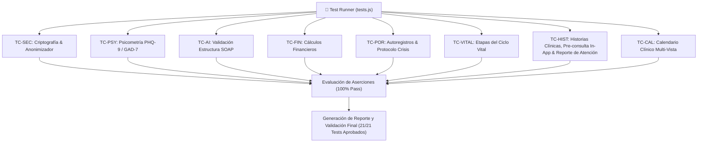

# 🧪 Psico Notes Clinical v6.0 — Plan Integral de Pruebas y Aseguramiento de Calidad (QA)

**Documento Oficial de Estrategia de Pruebas y Validación Automatizada**  
*Autor:* Agente 4 — Ingeniero de QA y DevOps  
*Aprobado por:* Agente 1 — Arquitecto de Software y PM  
*Fecha:* Octubre 2026  

---

## 1. Alcance y Estrategia de Pruebas

El presente documento define la matriz exhaustiva de pruebas unitarias, de integración, de seguridad criptográfica y de interfaz de usuario para **Psico Notes Clinical v6.0**.

### Objetivos de Calidad:
- **100% de Aprobación en Pruebas Unitarias de Lógica Crítica**: Criptografía AES-GCM, anonimización PHI, cálculo de escalas psicométricas (PHQ-9, GAD-7) y finanzas.
- **Cero Fugas de Datos PHI**: Garantizar que ningún dato identificable (nombre, cédula, teléfono, email) viaje en texto plano a modelos de IA.
- **Disponibilidad Offline y Resiliencia**: La aplicación debe operar sin errores aún sin conexión a internet ni API Key de Gemini (con fallback asistido determinista).

---

## 2. Matriz de Casos de Prueba Automatizados

| ID | Módulo | Caso de Prueba | Criterio de Éxito |
|---|---|---|---|
| **TC-SEC-01** | Criptografía | Cifrado y Descifrado Web Crypto AES-GCM 256-bit | Texto descifrado idéntico al texto original; ciphertext ininteligible |
| **TC-SEC-02** | Anonimizador | Detección y sustitución de nombres y teléfonos (PHI De-identifier) | Nombres y números convertidos a tokens `[PACIENTE_A]`, `[TEL_01]`; reconstrucción limpia |
| **TC-PSY-01** | Psicometría | Calificación automática PHQ-9 y severidad | Puntuación exacta (0-27); categorías Leve, Moderada, Severa correctas |
| **TC-PSY-02** | Psicometría | Detección de Riesgo Suicida en Ítem 9 PHQ-9 | Puntuación > 0 en ítem 9 activa `alertRisk: true` y despliega protocolo |
| **TC-PSY-03** | Psicometría | Calificación automática GAD-7 y rangos de ansiedad | Puntuación exacta (0-21); umbrales clínicos exactos |
| **TC-AI-01** | Asistente IA | Generación SOAP estructurado (Fallback Simulado / Gemini) | Retorna objeto JSON con llaves exactas: `subjetivo`, `objetivo`, `analisis`, `plan` |
| **TC-AI-02** | Asistente IA | Copiloto diagnóstico DSM-5-TR / CIE-11 | Retorna sugerencias clínicas estructuradas con diagnósticos diferenciales |
| **TC-FIN-01** | Finanzas | Cálculo de balance, ingresos cobrados y pendientes | Sumatorias matemáticas exactas sin desbordamiento decimal |
| **TC-POR-01** | Portal Paciente | Registro y validación de Autoregistro Cognitivo (ABC de Beck) | Estructura guardada con situación, pensamiento y emoción (0-100%) |
| **TC-POR-02** | Portal Paciente | Activación de Botón SOS / Protocolo de Crisis | Generación de alerta inmediata y presentación de líneas 24/7 |
| **TC-VITAL-01** | Ciclo Vital | Inferencia y Clasificación por Etapa Vital (Niñez, Adolescencia, Adultez) | Mapeo exacto <12a (child), 12-17a (adolescent), 18+a (adult) y fallback |
| **TC-VITAL-02** | Acompañamiento en la Niñez | Integridad de Expediente Pediátrico (Tutoría, Escuela, Neurodesarrollo) | Presencia de tutor legal, vínculo, escuela y consentimiento parental |
| **TC-VITAL-03** | Acompañamiento en Adolescencia | Marco Ético de Confidencialidad y Asentimiento Adolescente | Registro de alianza de confidencialidad y perspectiva propia del menor |
| **TC-VITAL-04** | Ciclo Vital | Filtrado Reactivo y Cómputo por Etapa Vital | Conteo exacto y filtrado multidimensional sin pérdida de expedientes |
| **TC-HIST-01** | Anamnesis Infantil | Integridad Perinatal, Parto, Hitos 0-3a y Ficha Biparental | Presencia de datos de ambos padres, tipo parto, somatometría e hitos motores |
| **TC-HIST-02** | Anamnesis Adolescente | Entrevista Confidencial, Identidad de Género y Metas | Validación del espacio reservado para afecto, sexualidad y metas propias |
| **TC-HIST-03** | Anamnesis Adulto | Áreas de Vida Adulta, Vivienda y Hábitos Psicobiológicos | Registro de esfera laboral, legal, dinámicas habitacionales, sueño y fobias |
| **TC-HIST-04** | Evolución de Sesión | Hoja de Evolución Oficial Protocolizada (Dual SOAP y Membrete Dinámico) | Estructuración de Objetivos, Técnicas, Hallazgos Clínicos y Próximas Sesiones con Membrete y Colegiatura |
| **TC-HIST-05** | Onboarding Digital | Ingesta y Parser Inteligente de Google Forms | Extracción y mapeo automático de campos tabulados a la ficha del paciente |
| **TC-HIST-06** | Pre-consulta In-App | Llenado Directo de Pre-consulta en la App e Integración al Expediente | Validación de formulario interno (18/32 campos) para creación y actualización inmediata sin enlaces externos |
| **TC-HIST-07** | Reporte de Atención | Reporte de Atención por Sesión de Terapia (Cálculo correlativo y mapeo oficial) | Validación del llenado obligatorio por sesión, cálculo automático de sesión correlativa, sincronización SOAP y exportación PDF |
| **TC-CAL-01** | Calendario Clínico | Calendario Clínico Multi-Vista (Día, Semana, Mes, Año y Citas en Cuadrícula) | Conmutación fluida entre 4 modos, pills de citas visibles en cada celda mensual, timeline diario 08:00-19:00, vista semanal de 7 columnas, mapa anual y zoom |
| **TC-POR-03** | Portal Paciente | Generación de Credenciales, Sincronización y Acceso Directo por Token | Token formato `PN-XXXXXXXX`, sincronización de datos y auto-login sin contraseña |
| **TC-DB-01** | Persistencia DB | Validación de Persistencia y Estructura de Base de Datos Relacional | Conexión, inicialización DDL, upsert de pacientes y búsqueda por token |
| **TC-DB-02** | Persistencia DB | Flujo Integral de Tareas, Autoregistro ABC y Monitoreo de Ánimo | Persistencia transaccional de tareas, autoregistros ABC, estados de ánimo y alertas SOS |

---

## 3. Arquitectura del Runner de Pruebas

Para garantizar compatibilidad universal sin dependencias externas pesadas, la suite se ejecutará mediante un motor de pruebas automatizado en JavaScript (`tests.js` / runner) con reportes detallados en consola y modal visual de QA integrado en la aplicación:

---

## 4. Criterios de Aceptación para Fase de Despliegue

1. **Suite de pruebas**: Todas las pruebas automatizadas pasan con status `PASSED` (0 errores).
2. **Compatibilidad cross-browser**: Funcionamiento verificado en Chrome, Edge, Firefox y Safari móvil.
3. **PWA Lighthouse Score**: Rendimiento offline, PWA instalable y tiempos de carga instantáneos.
